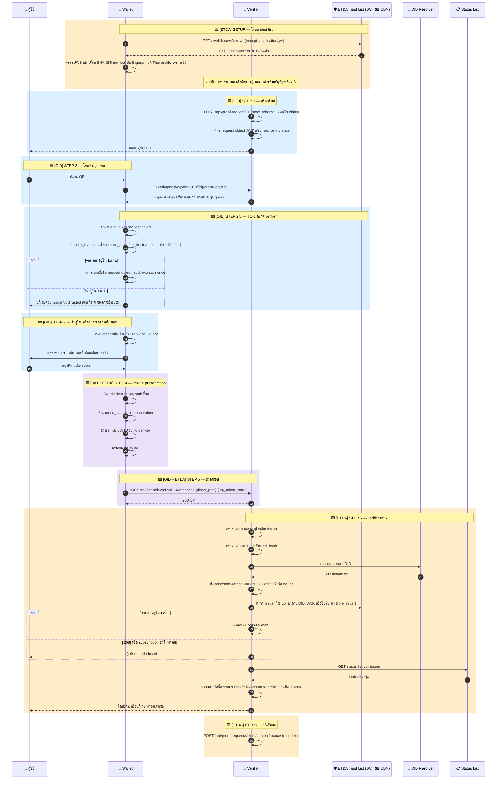

# ภาคผนวกบทที่ 8 — OID4VP Full Flow ทางเทคนิคโดยละเอียด

{/* METADATA (agent-only — not rendered to readers)
> **สถานะ:** 📄 Reference — เอกสารขยายเพิ่มเติมสำหรับบทที่ 8 Implementation Guidelines
> **เวอร์ชัน:** v1.1
> **วันที่:** 7 สิงหาคม 2569
> **แหล่งข้อมูล:** trust-guide/04-presentation-flow/02-full-flow/ (MASA-158)
> **เอกสารที่เกี่ยวข้อง:** [บทที่ 8 — Implementation Guidelines](08-implementation-guidelines.md) · [บทที่ 9 — Trust Model 3](09-trust-model-3.md) · [ภาคผนวก 8.1 — OID4VCI Full Flow](08.1-issuance-full-flow-detail.md)
*/}

---

## วัตถุประสงค์

ภาคผนวกนี้อธิบายกระบวนการแสดงและตรวจสอบเอกสารสำแดงดิจิทัลตามมาตรฐาน OID4VP (OpenID for Verifiable Presentations) [REF-OID4VP] แบบเต็มรูปแบบ (Full Flow) ตั้งแต่การเตรียมระบบ (SETUP) ถึงการตรวจสอบสถานะเอกสาร ผู้อ่านคือสถาปนิกระบบ ผู้พัฒนาซอฟต์แวร์ และผู้ตรวจสอบความสอดคล้อง เนื้อหาไล่ทีละขั้นและลงรายละเอียดถึงระดับ field

---

## ชั้นของขั้นตอนในเอกสารนี้

ทุกขั้นตอนในเอกสารนี้มีป้ายบอกว่ามาจากมาตรฐานหรือจาก Thai profile ทั้งสองบทใช้ป้ายชุดเดียวกันและใช้สีเดียวกันในแผนภาพ

| ป้าย | ความหมาย | ที่มาของขั้นตอน |
|---|---|---|
| 🟦 **[OID]** | ขั้นตอนที่มาตรฐานกำหนดไว้ครบแล้ว ทำตามมาตรฐานได้โดยไม่ต้องพึ่ง Thai profile | OID4VCI 1.0 หรือ OID4VP 1.0 |
| 🟨 **[ETDA]** | ขั้นตอนหรือจุดตรวจที่ ETDA trust framework เพิ่มเข้ามา ไม่มีในมาตรฐาน | Thai VC ARF |
| 🟪 **[OID + ETDA]** | กลไกมาจากมาตรฐาน แต่ Thai profile กำหนดว่าต้องใช้เมื่อใดหรืออย่างไร | ทั้งสองฝ่าย |

สีในแผนภาพตรงกับป้ายนี้ สีฟ้าคือ `[OID]` สีเหลืองคือ `[ETDA]` และสีม่วงคือ `[OID + ETDA]`

ผู้อ่านที่ต้องการทราบว่าต้องทำอะไรเพราะไทยกำหนด ให้ดูบล็อก 🟨 และ 🟪 ส่วนบล็อก 🟦 คือการใช้งานมาตรฐานตามปกติ

## จุดตรวจของ ETDA ในบทนี้

TC-1 ถึง TC-4 ย่อจาก Trust Check 1 ถึง Trust Check 4 ซึ่งเป็นจุดตรวจที่ ETDA Trust Model เพิ่มเข้ามาและไม่มีในมาตรฐาน OID รายละเอียดกลไกของแต่ละจุดอยู่ที่ [§8.4](08-implementation-guidelines.md)

| จุดตรวจ | ตรวจอะไร | ใครตรวจ | ทำเมื่อ |
|---|---|---|---|
| **Trust Check 1 (TC-1)** | ผู้ตรวจสอบเอกสารน่าเชื่อถือ และขอข้อมูลได้ตามขอบเขตที่ประกาศ | Wallet | ก่อนแสดง Consent ใน OID4VP |
| **Trust Check 2 (TC-2)** | Wallet น่าเชื่อถือ จาก WIA และ WIA-PoP ของทุก Wallet | Issuer ใน OID4VCI หรือ Verifier ใน OID4VP | ก่อนออก Access Token หรือก่อนรับ vp_token |
| **Trust Check 3 (TC-3)** | Issuer อยู่ใน Trusted List และลายมือชื่อ VC ใช้กุญแจที่ประกาศไว้ | Wallet หรือ Verifier | ก่อนขอ OTP และอีกครั้งหลังได้ VC |
| **Trust Check 4 (TC-4)** | สถานะของ VC ใน Status List ยังใช้งานได้ | Wallet หรือ Verifier | ทุกครั้งหลังผ่าน Trust Check 3 |

## E.0. 🟪 [OID + ETDA] แผนภาพ Sequence ฉบับสมบูรณ์ — Full Flow OID4VP (STEP 1–6)

แผนภาพต่อไปนี้แสดงภาพรวมของกระบวนการทั้งหมดตั้งแต่ SETUP จนถึงการตรวจสอบสถานะ:



**คำอธิบายแต่ละขั้นตอนโดยสังเขป:**

| ช่วง STEP | ชั้น | ขั้นตอน | คำอธิบาย |
|---|---|---|---|
| **SETUP** | 🟨 [ETDA] | ดึง Trusted List และตรวจลายมือชื่อเมื่อมีธุรกรรม | Wallet และ Verifier ดึง Trusted List ที่เกี่ยวข้องฉบับเต็มในรูปแบบ JWT จาก CDN เมื่อเกิดการเชื่อมต่อ โดยไม่ใช้ API key หรือ background polling แล้วตรวจลายมือชื่อด้วยใบรับรองใน header `x5c` ตามข้อ 12.1.3 |
| **STEP 1** | 🟦 [OID] | Prepare Authorization Request | Verifier สร้าง nonce, state + Request Object JWT พร้อม dcql_query + ลงนาม + สร้าง QR |
| **STEP 2** | 🟦 [OID] | Cross-device transfer | ผู้ใช้สแกน QR บนหน้าจอ Verifier ด้วย Wallet |
| **STEP 2.5** | 🟦 [OID] | Fetch Request Object | Wallet ดึง Request Object JWT ฉบับเต็มจาก request_uri |
| **TC-1** | 🟨 [ETDA] | Wallet ตรวจ Verifier | Wallet ตรวจ PK_v ใน Trusted List + verify RO sig + ตรวจขอบเขต claims + วัตถุประสงค์ |
| **STEP 3** | 🟦 [OID] | DCQL match + Consent | Wallet ค้นหา VC ในเครื่องที่ตรง DCQL → แสดง consent UI → ผู้ใช้อนุมัติ |
| **STEP 4** | 🟪 [OID + ETDA] | Build Presentation + WIA-PoP | Wallet สร้าง SD-JWT presentation และ KB-JWT; Wallet ทุกตัวสร้าง WIA-PoP ด้วย wallet instance key |
| **STEP 5** | 🟪 [OID + ETDA] | Authorization Response | Wallet ส่ง `vp_token` และ `state` ด้วย `direct_post`; Wallet ทุกตัว MUST ส่ง WIA และ WIA-PoP |
| **STEP 6 ⓪** | 🟨 [ETDA] | TC-2: Wallet Provider check | Verifier ตรวจ WIA และ WIA-PoP ของทุก Wallet ก่อนตรวจ KB-JWT |
| **STEP 6 ①** | 🟦 [OID] | KB-JWT — Holder binding | Verifier verify KB-JWT sig → ตรวจ sd_hash → ยืนยัน Holder ควบคุม key จริง |
| **STEP 6 ②** | 🟨 [ETDA] | TC-3: Issuer check | Verifier resolve DID → lookup PK_iss ใน Trusted List → verify issuer sig + disclosures |
| **STEP 6 ③** | 🟨 [ETDA] | TC-4: Status check | Verifier ดึง statuslist+jwt → อ่าน status ที่ idx ตามความกว้าง `bits` → ประมวลผลตามค่า |
| **STEP 7** | 🟨 [ETDA] | บันทึกผลและ trust detail | Verifier บันทึกผลการตรวจและ trust detail ไว้เป็นหลักฐานหลังให้บริการ |

---

## E.1. คำอธิบายทุกขั้นตอนโดยละเอียด

### E.1.1. 🟨 [ETDA] SETUP — การเตรียมระบบก่อนเริ่มใช้งาน

ก่อนเริ่มใช้งาน กระเป๋าเอกสารดิจิทัล (Wallet) และผู้ตรวจสอบเอกสาร (Verifier) MUST ดำเนินการเช่นเดียวกับ SETUP ในกระบวนการออกเอกสาร (ภาคผนวก 8.1):

1. ดึง Trusted List ที่เกี่ยวข้องฉบับเต็มในรูปแบบ JWT จาก CDN Wallet ดึง `https://trustme.etda.or.th/.well-known/ver.jwt` ส่วน Verifier ดึง `iss.jwt` และ `wp.jwt` จากจุดเดียวกัน การเผยแพร่ระยะนี้ไม่ใช้ API key, delta หรือไฟล์ CBOR
2. ตรวจลายมือชื่อ Trusted List ด้วยใบรับรองใน header `x5c` ตามข้อ 12.1.3 ไม่ต้องดึงกุญแจของ สพธอ. จาก `did.json` แล้วเก็บ snapshot ที่ตรวจลายมือชื่อแล้วไว้ในหน่วยความจำและใช้ซ้ำจนหมด soft TTL ตามข้อ 12.8
3. เก็บ `ETag` คู่กับ snapshot แล้วส่ง `If-None-Match` เมื่อ refresh ตามข้อ 12.8 [REF-TRUSTLIST-CDN]

**ข้อแตกต่างสำคัญ:** ใน OID4VP ผู้ดึง Trusted List คือ **กระเป๋าเอกสารดิจิทัลและผู้ตรวจสอบเอกสาร** (ใน OID4VCI คือ กระเป๋าเอกสารดิจิทัลและผู้ออกเอกสาร)

---

### E.1.2. 🟦 [OID] STEP 1 — ผู้ตรวจสอบเอกสารเตรียม Authorization Request

ผู้ตรวจสอบเอกสารดำเนินการดังนี้:

1. **สร้างค่าสุ่ม** `nonce` (ป้องกัน replay), `state` (เก็บ transaction context), `request_id`
2. **สร้าง Request Object JWT** บรรจุ `dcql_query` ระบุ:
   - `format: "dc+sd-jwt"` เป็น credential format ที่รองรับ
   - `vct_values` คือประเภท credential ที่ต้องการ
   - `claims[].path` คือ path ของ claims ที่ขอ
   - `credential_sets` คือเงื่อนไข credential ที่จำเป็น
3. **ลงนาม** Request Object ด้วย private key ของผู้ตรวจสอบเอกสาร
4. **สร้าง QR Code** บรรจุ `request_uri` เพื่อให้กระเป๋าเอกสารดิจิทัลดึง Request Object ฉบับเต็ม

---

### E.1.3. 🟦 [OID] STEP 2 — การโอนข้ามอุปกรณ์ (Cross-device Transfer)

1. ผู้ใช้เข้าถึงบริการของผู้ตรวจสอบเอกสาร (เช่น เว็บไซต์)
2. ผู้ตรวจสอบเอกสารแสดง QR Code บนหน้าจอ
3. ผู้ใช้สแกน QR Code ด้วยกระเป๋าเอกสารดิจิทัล

> **เหตุผล:** ใช้ cross-device flow เพราะกระเป๋าเอกสารดิจิทัลอยู่คนละอุปกรณ์กับผู้ตรวจสอบเอกสาร QR Code ส่งข้อมูลข้ามอุปกรณ์ได้โดยไม่ต้องเชื่อมต่อเครือข่ายถึงกัน

---

### E.1.4. 🟦 [OID] STEP 2.5 — การดึง Request Object ฉบับเต็ม

กระเป๋าเอกสารดิจิทัลส่ง HTTP GET ไปยัง `request_uri` ที่ระบุใน QR Code ผู้ตรวจสอบเอกสารตอบกลับด้วย Request Object JWT ฉบับเต็มที่ลงนามแล้ว

> **เหตุผล:** QR Code มีขนาดจำกัด ไม่สามารถบรรจุ Request Object ทั้งหมดได้ จึงส่งเป็น URI แทน

---

### E.1.5. 🟨 [ETDA] Trust Check 1 (TC-1) — กระเป๋าเอกสารดิจิทัลตรวจสอบผู้ตรวจสอบเอกสาร (ระหว่าง STEP 2.5 และ STEP 3)

**ความสำคัญ:** นี่คือจุดควบคุมความปลอดภัยที่สำคัญที่สุดของฝั่งกระเป๋าเอกสารดิจิทัล MUST ผ่านก่อนส่งข้อมูลใด ๆ

กระเป๋าเอกสารดิจิทัลดำเนินการ:

1. **แยก PK_v** จาก Request Object
2. **ตรวจสอบลายมือชื่อ Trusted List** L1: ตรวจด้วยใบรับรองใบแรกใน header `x5c` และเทียบ SHA-256 กับ fingerprint ที่ Thai profile ประกาศ ตามข้อ 12.1.3
3. **ค้นหา PK_v ใน `LoTE.TrustedEntitiesList[].TrustedEntityServices[]`** L2 ต้องพบบริการ Verifier ใน Trusted List และกุญแจตรงกับที่ประกาศไว้ [research/42](../research/42-trusted-list-lote-jwt-format.md)
4. **หากไม่พบ** → หยุดดำเนินการทันที ไม่ส่งข้อมูลใด ๆ
5. **หากพบ** → ดำเนินการตรวจสอบต่อ:
   - ตรวจสอบลายมือชื่อ Request Object ด้วย PK_v
   - `aud` ตรงกับเงื่อนไขของ OID4VP 1.0 §5.8: ถ้าผู้ตรวจสอบระบุผู้รับได้ ค่าต้องเท่ากับ `iss` ของ Request Object ถ้าระบุไม่ได้ ค่าต้องเป็น `https://self-issued.me/v2` (Thai profile กำหนดให้แคบกว่านี้ได้)
   - `exp`/`iat` ยังไม่หมดอายุ
   - `nonce` มีความยาว ≥ 128-bit (การตรวจสอบเชิงโครงสร้าง)
   - **ขอบเขต claims:** `dcql_query.claims[].path` ต้องอยู่ในขอบเขตที่ Thai profile ของบริการ Verifier อนุญาต
   - **วัตถุประสงค์:** `purpose` ต้องอยู่ในขอบเขตที่ Thai profile ของบริการ Verifier อนุญาต; JWT ตัวอย่างยังไม่มีฟิลด์นี้ จึงต้องปฏิเสธหากตรวจไม่ได้ [research/42](../research/42-trusted-list-lote-jwt-format.md)

---

### E.1.6. 🟦 [OID] STEP 3 — การจับคู่ DCQL ในเครื่องและการขอความยินยอม

กระเป๋าเอกสารดิจิทัลดำเนินการ:

1. **DCQL Match** สำหรับแต่ละ query ใน `dcql_query.credentials`:
   - กรอง credential ในเครื่องด้วย `format == "dc+sd-jwt"` และ `vct_values`
   - เดินตาม `claims[].path` ในแต่ละ credential เพื่อหา disclosure ที่ตรง
2. **ประเมิน credential_sets** ตรวจสอบว่า credential ในเครื่องตอบสนองเงื่อนไขที่จำเป็นได้หรือไม่
3. **แสดง Consent UI** แจ้งผู้ใช้:
   - ผู้ตรวจสอบเอกสารคือหน่วยงานใด (`legal_name` จาก Trusted List)
   - วัตถุประสงค์การขอข้อมูล (`purpose`)
   - Claims ที่จะเปิดเผย
4. **ผู้ใช้ตัดสินใจ** เลือกตัวเลือก (หากมีหลายทาง) และเลือก claims ที่ประสงค์จะเปิดเผย
5. **ปลดล็อกกุญแจ** ใช้ Biometric/PIN เพื่อปลดล็อก holder key และ wallet instance key

---

### E.1.7. 🟪 [OID + ETDA] STEP 4 — การสร้าง SD-JWT Presentation และ WIA-PoP

สำหรับแต่ละ credential ที่ผู้ใช้เลือก:

1. **เลือก Disclosures** เก็บเฉพาะ disclosures ที่ตรงกับ claims path ที่ผู้ตรวจสอบเอกสารขอ
2. **ประกอบ Presentation:** `issuer_jwt~disclosure_1~disclosure_2~...~`
3. **คำนวณ sd_hash:** `SHA-256(presentation_string)` (รวม `~` ตัวสุดท้าย)
4. **สร้าง KB-JWT (Key Binding JWT)** ลงนามด้วย holder key:
   - Header: `typ: "kb+jwt"`
   - Payload: `iss=holder`, `aud=client_id`, `nonce=⟨nonce จากผู้ตรวจสอบ⟩`, `sd_hash`, `iat`
5. **ประกอบขั้นสุดท้าย:** `issuer_jwt~disclosure_1~...~KB-JWT` → `vp_token[id]`

**Wallet MUST สร้าง WIA-PoP** Proof of Possession ลงนามด้วย wallet instance key และส่งในทุก Authorization Response
- `iss = wallet instance ID`, `aud = client_id`, `nonce = ⟨nonce จากผู้ตรวจสอบ⟩`, `jti`, `iat`, `exp`

Wallet ทุกตัว MUST ส่ง WIA และ WIA-PoP ครบคู่ ผู้ตรวจ MUST ปฏิเสธ VP เมื่อขาดรายการใด

> **หมายเหตุ:** ตามมาตรฐาน IETF SD-JWT VC (`dc+sd-jwt`) ไม่ต้องมี JWT-VP ห่ออีกชั้น เพราะ KB-JWT ทำหน้าที่ Holder Binding อยู่แล้ว

---

### E.1.8. 🟪 [OID + ETDA] STEP 5 — Authorization Response (`direct_post`)

ตัวอย่างนี้ใช้ `direct_post` และแสดงค่าพารามิเตอร์ก่อน form-encoding ให้ตรงกับตัวอย่างในบท 5 §5.4.1:

```json
{
  "vp_token": {
    "transcript": ["eyJ0eXAiOiJkYytzZC1qd3QiLCJhbGciOiJFZERTQSJ9...LUp~WyIzanFjYjY3ejl3a3NybmR2Iiwgc3R1ZGVudCIsICJOYXR0YXBvbmcgTWV0aGF3b24iXQ~eyJ0eXAiOiJrYitqd3QiLCJhbGciOiJFUzI1NiJ9...ziRjjF8Z3V5QkHEhZTFplqnqfk2BxEtZDA"]
  },
  "state": "8c17d20f4a936be105fd7c28a6403b91"
}
```

Wallet ส่ง Authorization Response ไปยัง `response_uri` ด้วย HTTP POST และ `Content-Type: application/x-www-form-urlencoded` Wallet serialize ค่า `vp_token` เป็น JSON string แล้ว form-encode ตาม OID4VP §8.2 [REF-OID4VP] เมื่อส่งตาม Thai profile ให้เพิ่ม `wallet_attestation` และ `wallet_attestation_pop` เป็นพารามิเตอร์ในคำขอเดียวกัน ไม่ใช่สมาชิกของ `vp_token`

**ส่วนขยาย Thai profile:** ตัวอย่างข้างต้นใช้พารามิเตอร์ OID4VP ตามรูปแบบเดียวกับบท 5 §5.4.1 และ Thai profile กำหนดให้ทุก Wallet เพิ่ม `wallet_attestation` และ `wallet_attestation_pop` ใน Authorization Response

---

### E.1.9. 🟨 [ETDA] STEP 6 — ผู้ตรวจสอบเอกสารดำเนินการตรวจสอบ

ผู้ตรวจสอบเอกสารค้นหา transaction context จาก `state` แล้วเข้าสู่การตรวจ TC-2

#### ⓪ Trust Check 2 (TC-2) — การตรวจสอบผู้ให้บริการกระเป๋า

เมื่อใช้ TC-2 ต้องมีหลักฐานครบทั้งคู่ คือ WIA และ WIA-PoP WIA ยืนยันผู้ให้บริการกระเป๋าและ Wallet Unit ส่วน WIA-PoP แสดงการครอบครองกุญแจที่ผูกกับ WIA ในธุรกรรมปัจจุบัน

Wallet MUST ส่งหลักฐานครบทั้งคู่ หากขาดรายการใดรายการหนึ่ง ผู้ตรวจ MUST ปฏิเสธ VP


เมื่อทำ TC-2 ให้ดำเนินการดังนี้:

1. แยก WIA → ได้ `iss` (WP ID) + `PK_wp`
2. **L3:** ค้นหา PK_wp ในบริการ Wallet Provider ของ `LoTE.TrustedEntitiesList[].TrustedEntityServices[]` [research/42](../research/42-trusted-list-lote-jwt-format.md)
3. หากไม่พบ → `400 untrusted_wallet_provider`
4. หากพบ:
   - ตรวจสอบลายมือชื่อ WIA ด้วย PK_wp → `iat ≤ now < exp`
   - ตรวจสอบลายมือชื่อ WIA-PoP ด้วย `WIA.cnf.jwk` → `iss == WIA.sub`, `aud == client_id`, `nonce` ตรง
   - Mark `jti` consumed (ป้องกัน replay)


#### ① KB-JWT — Holder Binding (SD-JWT native)

สำหรับแต่ละ credential ใน `vp_token`:

1. แยก `vp_token[id]` ด้วย `~` → `issuer_jwt`, `disclosures[]`, `KB-JWT`
2. จาก `issuer_jwt`: ดึง `cnf.jwk` (holder key) + `iss` (issuer DID) + `kid`
3. ตรวจสอบลายมือชื่อ KB-JWT ด้วย `issuer_jwt.cnf.jwk`:
   - `aud == client_id`
   - `nonce == issued_nonce`
   - `iat` เป็นเวลาปัจจุบัน
4. คำนวณ `sd_hash` ใหม่จาก `issuer_jwt~d1~d2~...~` → ตรงกับ `KB-JWT.sd_hash`
5. Mark nonce + KB-JWT `jti` consumed

#### ② Trust Check 3 (TC-3) — การตรวจสอบผู้ออกเอกสาร

1. **L6:** resolve issuer DID ผ่าน resolver ของ DID method นั้น หรือ resolver ของ สพธอ. สำหรับ public DID method → dereference `kid` ใน `didDocument.assertionMethod[]` → ได้ `publicKeyJwk` (PK_iss)
2. **L4:** ค้นหา PK_iss ในบริการ Issuer ของ `LoTE.TrustedEntitiesList[].TrustedEntityServices[]` [research/42](../research/42-trusted-list-lote-jwt-format.md)
3. หากไม่พบ → `400 untrusted_issuer (key)`
4. หากพบ:
   - บริการ Verifier ต้องอยู่ใน Trusted List และกุญแจตรงกับที่ประกาศไว้
   - `vct` ต้องอยู่ในขอบเขตประเภท VC ที่ Issuer ได้รับอนุญาตตาม Thai profile
   - หากต้องตรวจช่วงเวลากุญแจหรือ DID method ต้องมีข้อมูลดังกล่าวใน Thai profile ที่ประกาศใช้; หากไม่มี ให้ปฏิเสธ
5. ตรวจสอบลายมือชื่อ `issuer_jwt` ด้วย PK_iss → `nbf ≤ now ≤ exp`
6. ตรวจสอบ disclosures: `hash(d)` ∈ `issuer_jwt._sd` → parse `[salt, claim_name, claim_value]` → build `reconstructed_credential`
7. DCQL match กับ reconstructed credential → claims path มีค่า และ value ตรง (หากระบุ)

#### ③ Trust Check 4 (TC-4) — การตรวจสอบสถานะเอกสาร

หาก `issuer_jwt` มี `status.status_list`:

1. อ่าน `uri` และ `idx` จาก `status.status_list`
2. GET `uri` (Accept: `application/statuslist+jwt`) → statuslist+jwt
3. ตรวจสอบ statuslist JWT:
   - `typ == "statuslist+jwt"`
   - `sub == URI` ของ Status List
   - `now > iat`, `now < exp`
   - ลงนามโดย PK_iss (จาก L6)
4. ประมวลผล Referenced Token ก่อน รวมทั้งลายมือชื่อและ `exp`; token ที่ไม่ผ่านหรือหมดอายุต้องปฏิเสธ แม้ status จะเป็น `0x00`.
5. Decode `lst`: base64url → DEFLATE ตามรูปแบบ ZLIB → อ่านค่า status ที่ `idx` ตามความกว้าง `bits` [REF-TSL, draft-ietf-oauth-status-list-21 §4.1].
6. ตีความ `0x00 = VALID`, `0x01 = INVALID` และ `0x02 = SUSPENDED`; ปฏิเสธค่า application-specific หรือค่า status อื่นที่ Thai profile ไม่รองรับ [REF-TSL, draft-ietf-oauth-status-list-21 §7.1].

---

## E.2. 🟨 [ETDA] สรุปจุดตรวจ L1–L7 ใน Full Flow OID4VP

| จุดตรวจ | ผู้ดำเนินการตรวจ | สิ่งที่ตรวจ | อ้างอิง Trusted List |
|:-------:|-----------------|-----------|:-----------------:|
| **L1** | Wallet / Verifier | ตรวจสอบลายมือชื่อ JWT ของ Trusted List ด้วยใบรับรองใน header `x5c` | ใบรับรองใน header ของ JWT |
| **L2** | Wallet | ค้นหา Verifier PK ในบริการที่เกี่ยวข้อง | `LoTE.TrustedEntitiesList[].TrustedEntityServices[]` |
| **L3** | Verifier | ค้นหา Wallet Provider PK ในบริการที่เกี่ยวข้อง เมื่อทำ TC-2 | `LoTE.TrustedEntitiesList[].TrustedEntityServices[]` |
| **L4** | Verifier | ค้นหา Issuer PK ในบริการที่เกี่ยวข้อง | `LoTE.TrustedEntitiesList[].TrustedEntityServices[]` |
| **L6** | Verifier | Dereference kid ใน DID Document แล้วเทียบกุญแจที่ได้กับกุญแจของ Issuer ที่ประกาศใน Trusted List (DID, JWK หรือใบรับรอง) | DID Resolver และ `ServiceDigitalIdentity` |
| **L7** | Verifier | Decode Status List status slot | Issuer Status List |

> **หมายเหตุ:** L5 (reserved สำหรับ Wallet Attestation) ตรวจสอบ WUA Status List แบบ privacy-preserving [REF-CIR-WUA] เมื่อ Wallet ส่ง WIA และ TC-2 ทำงาน

---

{/* METADATA (agent-only — not rendered to readers)
## อ้างอิง

- [REF-OID4VP] OpenID Foundation, "OpenID for Verifiable Presentations 1.0 Final" — https://openid.net/specs/openid-4-verifiable-presentations-1_0.html
- [REF-SDJWT] IETF, “SD-JWT-based Verifiable Digital Credentials (SD-JWT VC),” draft-ietf-oauth-sd-jwt-vc-19, 31 August 2026 (Internet-Draft; status as of 1 October 2026: Waiting for AD Go-Ahead) — https://datatracker.ietf.org/doc/draft-ietf-oauth-sd-jwt-vc/
- [REF-TSL] IETF, “Token Status List (TSL),” draft-ietf-oauth-status-list-21, 21 June 2026 (Internet-Draft; status as of 1 October 2026: RFC Editor — Awaiting First editor) — https://datatracker.ietf.org/doc/draft-ietf-oauth-status-list/
- [REF-DID-CORE] W3C, "Decentralized Identifiers (DIDs) v1.0", 19 July 2022
- [REF-ARF] European Commission, "EUDI Architecture and Reference Framework v2.9.0"
- [REF-CIR-WUA] (EU) CIR 2024/2979, "Wallet Unit Attestation"
- [REF-MASA-158] MASA-158 — Merge OID4VP Full Flow from trust-guide into ARF (2026-08-07)
- [REF-TRUSTLIST-CDN] คณะทำงาน VC, "แนวทางกระจาย Trustlist (LoTE) ผ่าน File/Edge CDN — ไม่ใช้ RabbitMQ", เวอร์ชัน 1.10, 4 กันยายน 2569 — [research/41](../research/41-trustlist-serving-filecdn-etag-binary.md)

---
*/}

**การนำทาง:** [⬅️ กลับไปบทที่ 8 — Implementation Guidelines](08-implementation-guidelines.md) · [⬆️ สารบัญ ARF](README.md) · [ภาคผนวก 8.1 — OID4VCI Full Flow ➡️](08.1-issuance-full-flow-detail.md)
