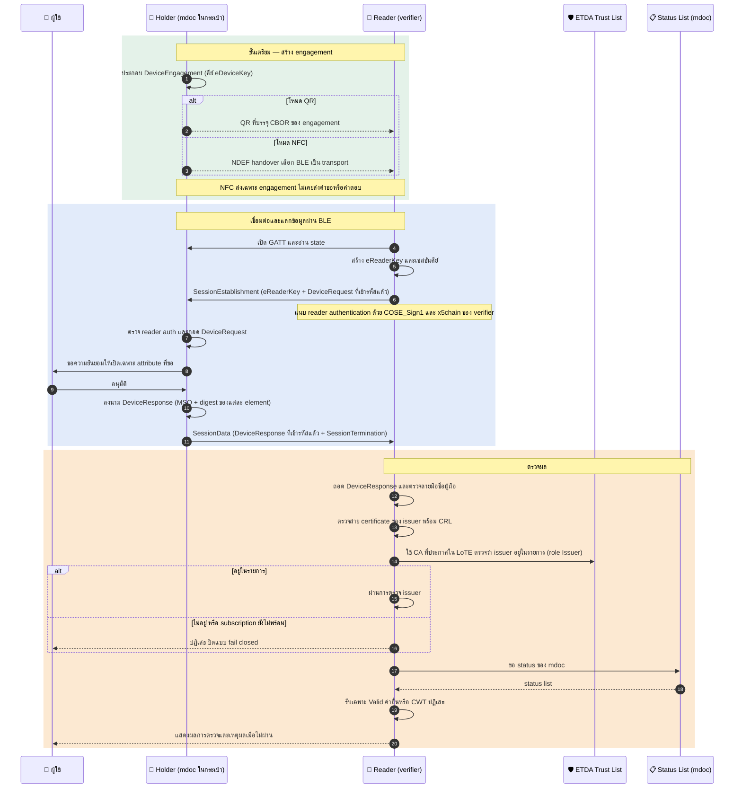

# ภาคผนวกบทที่ 8 — Proximity Full Flow (mdoc ผ่าน NFC และ Bluetooth LE)

{/* METADATA (agent-only — not rendered to readers)
> **สถานะ:** 📄 Reference — เอกสารขยายเพิ่มเติมสำหรับบทที่ 8 Implementation Guidelines
> **เวอร์ชัน:** v1.1
> **วันที่:** 16 พฤศจิกายน 2569
> **แหล่งข้อมูล:** ISO/IEC 18013-5 และการติดตั้งอ้างอิงของ สพธอ.
> **เอกสารที่เกี่ยวข้อง:** [บทที่ 8 — Implementation Guidelines](08-implementation-guidelines.md) · [ภาคผนวก 8.1 — OID4VCI Full Flow](08.1-issuance-full-flow-detail.md) · [ภาคผนวก 8.2 — OID4VP Full Flow](08.2-oid4vp-full-flow-detail.md)
*/}

---

## วัตถุประสงค์

ภาคผนวกนี้อธิบายเส้นทางการยื่นเอกสารรับรองแบบเผชิญหน้า (proximity) ตาม ISO/IEC 18013-5 [REF-ISO18013-5] ซึ่งเป็นเส้นทางที่แยกจาก OID4VP ในภาคผนวก 8.2 ผู้อ่านคือผู้พัฒนากระเป๋าเอกสารดิจิทัลและผู้พัฒนาผู้ตรวจสอบเอกสารที่ต้องรองรับการตรวจบัตรประชาชนดิจิทัลผ่าน NFC หรือ Bluetooth LE

ขอบเขตของบทนี้คือการแลกเปลี่ยนข้อมูล การตรวจความน่าเชื่อถือ และการตรวจสถานะ ไม่ครอบคลุมการออกเอกสารให้ผู้ถือ ซึ่งอยู่ในภาคผนวก 8.1 และไม่ครอบคลุมการออกแบบหน้าจอของผู้ตรวจสอบ

จุดที่ต้องอ่านให้ครบคือส่วนการตรวจความน่าเชื่อถือ เพราะเส้นทางนี้ตรวจผู้ออกเอกสารด้วยกลไกเดียวกับที่ผู้ถือใช้ แต่เข้มกว่าเส้นทาง OID4VP ในจุดที่เอกสาร SD-JWT VC ยังไม่ตรวจ ผู้อ่านที่ข้ามส่วนนี้จะเข้าใจผิดว่าระบบตรวจผู้ออกเอกสารครบทุกเส้นทางแล้ว

---

## F.0. แผนภาพ Sequence ฉบับสมบูรณ์ — Full Flow Proximity

แผนภาพต่อไปนี้แสดงภาพรวมของกระบวนการทั้งหมดตั้งแต่การสร้าง engagement จนถึงการตรวจสอบสถานะ:

| ช่วงขั้น | ขั้นตอน | คำอธิบาย |
|-----------|---------|----------|
| **SETUP** | ดึง Trusted List | ผู้ตรวจสอบดึง LoTE บทบาท Issuer จาก CDN และตรวจลายมือชื่อด้วยใบรับรองใน header `x5c` ตามข้อ 12.1 |
| **Step 1** | สร้าง engagement | ผู้ถือสร้าง DeviceEngagement ที่ผูกกับคีย์ eDeviceKey และแสดงเป็น QR หรือส่งผ่าน NFC |
| **Step 2** | โอนข้ามอุปกรณ์ | ผู้ตรวจสอบอ่าน engagement จาก QR หรือจาก NDEF handover ที่ระบุให้ใช้ Bluetooth LE เป็น transport |
| **Step 3** | เปิดเซสชัน | ผู้ตรวจสอบเปิด GATT สร้าง eReaderKey และส่ง SessionEstablishment พร้อม reader authentication |
| **Step 4** | ขอและให้ความยินยอม | ผู้ถือถอด DeviceRequest แล้วขอความยินยอมจากผู้ใช้เฉพาะ attribute ที่ถูกขอ |
| **Step 5** | ส่ง DeviceResponse | ผู้ถือลงนาม DeviceResponse พร้อม MSO และ digest ของแต่ละ element แล้วส่งกลับใน SessionData |
| **Step 6** | ตรวจผู้ออกเอกสาร | ผู้ตรวจสอบตรวจลายมือชื่อผู้ถือ ตรวจสาย certificate ของ issuer แล้วตรวจว่า issuer อยู่ใน LoTE |
| **Step 7** | ตรวจสถานะ | ผู้ตรวจสอบอ่าน status ของ mdoc และยอมรับเฉพาะสถานะที่ใช้งานได้ |
| **Step 8** | แสดงผล | ผู้ตรวจสอบแสดงผลและเหตุผลเมื่อไม่ผ่าน โดยไม่เปิดเผย attribute ที่ไม่ได้ขอ |

---

## F.1. คำอธิบายทุกขั้นตอนโดยละเอียด

### F.1.1. SETUP — การเตรียม trust list

ผู้ตรวจสอบเตรียม Trusted List ก่อนเริ่มรับคำขอ กลไกเหมือนภาคผนวก 8.2 ทุกประการ คือดึงไฟล์ JWT จาก CDN ตรวจลายมือชื่อด้วยใบรับรองใบแรกใน header `x5c` และตรวจว่า SHA-256 ของใบรับรองนั้นตรงกับค่า fingerprint ที่ Thai profile ประกาศไว้

ความต่างอยู่ที่บทบาทที่ใช้ค้น ระหว่างการยืนยันตัวผู้ออกเอกสาร เส้นทางนี้ค้นบัญชีด้วยบทบาท Issuer โดยตรง ไม่ได้แยกเป็น PID provider หรือ QEAA provider ตามที่เส้นทาง OID4VP ทำ

ผู้ตรวจสอบ **MUST** เตรียมบัญชีนี้ให้พร้อมก่อนเปิดรับคำขอ ถ้าบัญชียังไม่พร้อม ผู้ตรวจสอบ **MUST** ปฏิเสธคำขอทุกครั้ง ไม่ใช่ปล่อยผ่านเพราะยังไม่มีข้อมูลเปรียบเทียบ

บัญชีที่โหลดไว้ **MUST** ถูกทำให้สดใหม่ตามรอบที่ Thai profile กำหนด การใช้บัญชีที่เก่าเกินรอบทำให้ตรวจผู้ออกที่ถูกถอดออกไปแล้วว่ายังใช้ได้ ผู้ตรวจสอบ **SHOULD** บันทึกเวลาที่โหลดล่าสุดไว้กับผลการตรวจ เพื่อให้ตรวจย้อนหลังได้ว่าตัดสินด้วยบัญชีชุดใด

### F.1.2. Step 1 — การสร้าง Engagement

ผู้ถือสร้าง DeviceEngagement ที่ผูกกับคีย์ของอุปกรณ์ หรือ eDeviceKey สำหรับเซสชันนี้ Engagement ประกอบด้วยข้อมูลการเชื่อมต่อและคีย์สาธารณะที่ผู้ตรวจสอบต้องใช้สร้างเซสชัน

ช่องทางส่งมีสองแบบ ผู้ถืออาจแสดงเป็น QR code ที่บรรจุข้อมูล CBOR หรือส่งผ่าน NFC แบบ static handover ในโหมด NFC ข้อมูลที่ส่งมีเพียง engagement กับตัวเลือกว่าให้ใช้ Bluetooth LE เป็น transport เท่านั้น คำขอและคำตอบไม่เคยเดินทางผ่าน NFC

ผู้ถือ **MUST** สร้าง engagement ใหม่สำหรับทุกเซสชัน และ **MUST NOT** นำ engagement เดิมกลับมาใช้ซ้ำ เพราะกุญแจผูกกับเซสชันเดียว

### F.1.3. Step 2 และ Step 3 — การเปิดเซสชัน

ผู้ตรวจสอบอ่าน engagement แล้วเปิดการเชื่อมต่อ GATT กับผู้ถือ จากนั้นสร้างคู่กุญแจของผู้อ่าน หรือ eReaderKey ขึ้นใหม่สำหรับเซสชันนี้ และคำนวณกุญแจเซสชันจากคีย์ทั้งสองฝ่าย

ผู้ตรวจสอบ **MUST** ส่ง SessionEstablishment ที่บรรจุ eReaderKey กับ DeviceRequest ที่เข้ารหัสแล้ว และ **MUST** แนบ reader authentication ซึ่งเป็นโครงสร้าง COSE_Sign1 พร้อมสายใบรับรองของผู้อ่าน หรือ x5chain

ผู้ถือ **MUST** ตรวจ reader authentication ก่อนถอด DeviceRequest ถ้าตรวจไม่ผ่าน ผู้ถือ **MUST NOT** ถอดคำขอและ **MUST NOT** ส่งข้อมูลใด ๆ กลับ

### F.1.4. Step 4 — การขอและให้ความยินยอม

เมื่อถอด DeviceRequest ได้ ผู้ถือต้องตรวจว่าคำขอมาจากผู้อ่านที่ผ่านการยืนยันแล้ว และต้องแสดงให้ผู้ใช้เห็นเฉพาะ attribute ที่ถูกขอเท่านั้น

ผู้ใช้เป็นผู้อนุมัติการเปิดเผย attribute ผู้ถือ **MUST NOT** ส่งข้อมูลที่ผู้ใช้ไม่ได้อนุมัติ และ **MUST NOT** ส่ง attribute ที่ไม่ได้อยู่ในคำขอ การตรวจนี้เป็นการป้องกันการขยายขอบเขตคำขอระหว่างทาง

### F.1.5. Step 5 — การสร้าง DeviceResponse

ผู้ถือสร้าง DeviceResponse ที่บรรจุ MSO ซึ่งเป็นโครงสร้างที่ผู้ออกเอกสารลงนามไว้ พร้อมค่า digest ของแต่ละ element ที่เปิดเผย

ผู้ถือ **MUST** ลงนาม DeviceResponse ด้วยคีย์ของอุปกรณ์ แล้วส่งกลับใน SessionData ที่เข้ารหัสด้วยกุญแจเซสชัน เมื่อส่งครบผู้ถือ **MUST** ปิดเซสชันด้วย SessionTermination

ผู้ถือ **MUST NOT** เปิด element ที่ผู้ใช้ไม่ได้อนุมัติ แม้ผู้อ่านจะขอไว้ในคำขอเดิม เพราะการเปิดเกินขอบเขตทำให้ตรวจย้อนหลังไม่ได้ว่าใครเปิดอะไร

### F.1.6. Step 6 — การตรวจผู้ออกเอกสาร

ผู้ตรวจสอบ **MUST** ตรวจสองชั้น ชั้นแรกคือลายมือชื่อของผู้ถือบน DeviceResponse และความสอดคล้องของ digest กับ MSO ชั้นที่สองคือสายใบรับรองของผู้ออกเอกสาร พร้อมการตรวจการเพิกถอนผ่าน CRL

เมื่อสายใบรับรองผ่าน ผู้ตรวจสอบ **MUST** ตรวจว่าใบรับรองของผู้ออกออกโดยหน่วยงานรับรองที่ประกาศไว้ใน Trusted List ของ สพธอ. การตรวจชั้นนี้คือจุดที่ตัดสินว่าผู้ออกเอกสารเป็นที่ยอมรับหรือไม่

กลไกการจับคู่ทำที่ระดับหน่วยงานรับรอง ผู้ตรวจสอบอ่านค่า `AuthorityKeyIdentifier` จากใบรับรองของผู้ออก แล้วหาหน่วยงานรับรองที่มี `SubjectKeyIdentifier` ตรงกันในบัญชี ถ้าไม่พบบันทึกที่ตรงกัน ผู้ตรวจสอบ **MUST** ปฏิเสธ ผู้ออกที่สายใบรับรองสมบูรณ์แต่มาจากหน่วยงานรับรองที่ไม่ได้ประกาศไว้จึงไม่ผ่าน

ถ้าองค์กรยังไม่ขึ้นทะเบียน หรือ subscription ยังไม่พร้อม ผู้ตรวจสอบ **MUST** ปฏิเสธ ไม่ใช่ปล่อยผ่าน การตรวจลายมือชื่อเพียงอย่างเดียวไม่บอกว่าผู้ออกเป็นที่ยอมรับ เพราะผู้ที่สร้างเอกสารปลอมย่อมลงนามด้วยคีย์ของตัวเองได้

### F.1.7. Step 7 และ Step 8 — การตรวจสถานะและการแสดงผล

ผู้ตรวจสอบ **MUST** อ่าน status ของเอกสารจาก Status List ที่ผู้ออกเอกสารประกาศ และ **MUST** ยอมรับเฉพาะสถานะที่ใช้งานได้ ค่าที่ไม่รู้จัก **MUST** ถือว่าไม่ผ่าน

เมื่อตรวจครบ ผู้ตรวจสอบต้องแสดงผลให้ผู้ใช้เห็น และเมื่อไม่ผ่านต้องแสดงเหตุผลโดยไม่เปิดเผยเนื้อหาเอกสาร ผู้ตรวจสอบ **MUST NOT** เก็บ attribute ที่ไม่ได้ใช้ต่อหลังจบเซสชัน

---

## F.2. สรุปจุดตรวจ

| จุดตรวจ | ผู้ตรวจ | สิ่งที่ตรวจ | ผลเมื่อไม่ผ่าน | ขั้นที่เกิด |
|:-------:|---------|-------------|----------------|:-----------:|
| P1 | ผู้ถือ | reader authentication ของผู้อ่าน | ไม่ส่งข้อมูลใด ๆ | Step 3 |
| P2 | ผู้ตรวจสอบ | ลายมือชื่อผู้ถือบน DeviceResponse | ปฏิเสธคำตอบ | Step 6 |
| P3 | ผู้ตรวจสอบ | digest ของ element เทียบกับ MSO | ปฏิเสธคำตอบ | Step 6 |
| P4 | ผู้ตรวจสอบ | สายใบรับรองของผู้ออกและการเพิกถอน | ปฏิเสธคำตอบ | Step 6 |
| P5 | ผู้ตรวจสอบ | ผู้ออกเอกสารใน Trusted List บทบาท Issuer | ปฏิเสธแบบ fail closed | Step 6 |
| P6 | ผู้ตรวจสอบ | สถานะของเอกสารใน Status List | ปฏิเสธคำตอบ | Step 7 |

---

## F.3. ข้อแตกต่างจากเส้นทาง OID4VP

| ประเด็น | OID4VP (ภาคผนวก 8.2) | Proximity (บทนี้) |
|---------|----------------------|-------------------|
| ช่องทางขนส่ง | HTTPS ผ่าน `direct_post` | Bluetooth LE สำหรับคำขอและคำตอบ และ NFC เฉพาะ engagement |
| การตรวจผู้ออกเอกสาร | ไม่มีในเส้นทางปกติ นอกจาก issuer เป็น certificate ในหมวด PID หรือ QEAA | ตรวจทุกครั้งด้วยบทบาท Issuer |
| รูปแบบสถานะ | Status List Token แบบ SD-JWT | Status List ของ mdoc ซึ่งเป็นคนละกลไก |
| การยืนยันตัวผู้ขอ | request object ที่ลงนามและตรวจด้วย Trusted List | reader authentication ด้วย COSE_Sign1 และ x5chain |
| การขอความยินยอม | เกิดในกระเป๋าก่อนประกอบ presentation | เกิดหลังถอด DeviceRequest และก่อนสร้าง DeviceResponse |

---

## F.4. ข้อจำกัดที่พบในการทำงานร่วมกัน

ข้อจำกัดสามข้อต่อไปนี้กำหนดวิธีที่ผู้ออกเอกสารและผู้ตรวจสอบต้องเลือกใช้กลไกในบทนี้

- Status List ของ mdoc ที่ลงนามรูปแบบ CWT ใช้กับผู้ตรวจสอบที่รับเฉพาะรูปแบบ JWT ไม่ได้ ผู้ออกเอกสาร **MUST** เลือกรูปแบบที่ตรงกับผู้ตรวจ หรือรอให้ทั้งสองฝั่งรองรับรูปแบบเดียวกัน
- ผู้ออก Status List **MUST** เป็นผู้ออกเอกสารรายเดียวกัน ถ้าลงนามโดยรายอื่นจะไม่ผ่านการตรวจ แม้จะเป็นการมอบหมายที่ถูกต้องตามนโยบาย
- การค้นบัญชีใน Trusted List อ้างอิงบทบาทและ scope ที่กำหนดไว้ล่วงหน้า ผู้ตรวจสอบ **MUST** ตรวจสอบว่า scope ที่ใช้ตรงกับ ecosystem ของตนก่อนนำไปใช้กับหลาย ecosystem

---

## อ้างอิง

- [REF-ISO18013-5] ISO/IEC 18013-5, "Personal identification — ISO-compliant driving licence — Part 5: Mobile driving licence (mDL) application"
- [REF-OID4VP] OpenID Foundation, "OpenID for Verifiable Presentations 1.0 Final", 15 July 2025 — https://openid.net/specs/openid-4-verifiable-presentations-1_0.html
- [REF-CIR-WUA] (EU) CIR 2024/2979, "Wallet Unit Attestation"

---

**การนำทาง:** [⬅️ กลับไปบทที่ 8 — Implementation Guidelines](08-implementation-guidelines.md) · [⬆️ สารบัญ ARF](README.md) · [ภาคผนวก 8.2 — OID4VP Full Flow](08.2-oid4vp-full-flow-detail.md)
