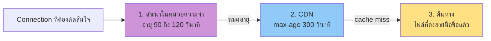
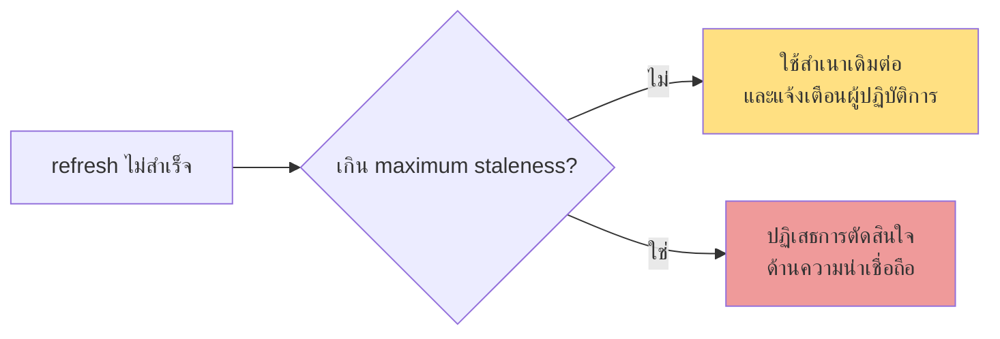
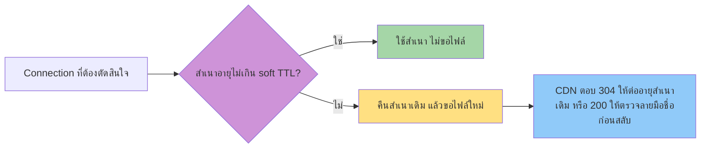

# 12. Key Management, Key Rotation และ Trusted List Deployment

{/* METADATA (agent-only — not rendered to readers)
> **สถานะ:** 📐 Specification — Draft สำหรับการทบทวนเชิงกำกับดูแล (S8, MASA-129 → MASA-153)
> **เวอร์ชันเอกสาร:** 1.2.5 (2026-09-23) — ประวัติการแก้ไขทั้งหมดดูได้ที่ §12.11 บันทึกการเปลี่ยนแปลง
> **แหล่งข้อมูล:** เอกสารสถาปัตยกรรมภายใต้ `th/architecture/` และงานวิจัยภายใน `th/research/` — ดู §12.10 References
> **ขอบเขต:** เอกสารกำกับดูแลและข้อกำหนดสำหรับการตรวจประเมิน ห้ามตีความเป็นผลทดสอบ production
> **เอกสารที่เกี่ยวข้อง:** [11-cryptographic-suites.md](11-cryptographic-suites.md), [13-vc-status-and-revocation.md](13-vc-status-and-revocation.md), [14-security-threat-model-and-conformance.md](14-security-threat-model-and-conformance.md), [ดัชนีเอกสาร ARF](README.md)
*/}

---

บทที่ 12 กำหนดข้อกำหนดการจัดการกุญแจ (key management) การหมุนเวียนกุญแจ (key rotation) และการวางระบบ Trusted List (Trusted List deployment) รวมถึงการควบคุมระดับเครือข่ายและการดึง Trusted List ผ่าน CDN ด้าน cryptographic suites อยู่ในบทที่ 11 และการเพิกถอน VC ด้วย status list อยู่ในบทที่ 13 รายละเอียดประเภท จำนวนไฟล์ รูปแบบ และโครงสร้างข้อมูลของ Trust List อยู่ใน [ข้อกำหนดการเผยแพร่ Trust List](12.1-trust-list-publication-profile.md)

---

## 12.1 ขอบเขตและการจำแนกข้อความ

หัวข้อนี้รวมข้อกำหนดด้านการจัดการกุญแจและการวางระบบ Trusted List คือ (1) Key Management และ Key Rotation (2) Resolver และ Network Controls และ (3) การดึง Trusted List แบบ lazy ผ่าน CDN ด้วย HTTP `GET`

**การจำแนกข้อความและกฎการอ้างอิงของบทนี้:** ใช้ตาม[ภาคผนวก ค](15-appendix.md) ซึ่งรวมกฎการอ้างอิง ป้ายจำแนกข้อความ และความหมายของ MUST / MUST NOT / SHOULD / MAY

---

## 12.2 ข้อกำหนดการเก็บกุญแจ

**[ข้อเท็จจริง]** ข้อกำหนดการจัดการกุญแจแยกตามผู้ถือกุญแจสี่กลุ่ม ได้แก่ ผู้ออกเอกสาร (issuer) ระบบ Trusted List ของ สพธอ. กระเป๋าเอกสารดิจิทัลของผู้ถือเอกสาร (holder) และผู้ตรวจสอบเอกสาร (verifier) ทั้งนี้ ผู้ตรวจสอบเอกสารต้องมีกุญแจของตนเองเช่นกัน เนื่องจากต้องลงลายมือชื่อ Request Object คือ `client_metadata_jwt` ในคำขอ VP ตาม OID4VP เพื่อให้กระเป๋าเอกสารดิจิทัลตรวจได้ว่าคำขอมาจากผู้ตรวจสอบเอกสารตัวจริง [A-ACP §1, §5.2]

| ผู้ถือกุญแจ | ข้อกำหนด | หลักฐาน | ที่มา |
|------------|---------|---------|-------|
| Issuer | กุญแจลงลายมือชื่ออยู่ใน HSM ระดับ FIPS 140-2 Level 3 | ใบรับรอง HSM | [A-ARCH §8 I1] |
| Issuer | พิธีสร้างกุญแจต้องมีพยานและบันทึกวิดีโอ | รายงานพิธี | [A-ARCH §8 I2] |
| Issuer | แผนหมุนเวียนกุญแจประจำปีเป็นเอกสาร | เอกสารนโยบาย | [A-ARCH §8 I3] |
| ETDA (Trusted List) | กุญแจอยู่ใน HSM ที่ export ไม่ได้ ระดับ FIPS 140-3 Level 3 ขึ้นไป | — | [A-TM §T1] |
| ETDA (Trusted List) | การลงลายมือชื่อ TL ต้องใช้ quorum แบบ M-of-N เช่น 3-of-5 | — | [A-TM §T1] |
| ETDA (Trusted List) | มี emergency key แบบ offline air-gapped สำหรับเพิกถอนกุญแจที่ถูก compromise | — | [A-TM §T1] |
| Wallet (Holder) | กุญแจต้องสร้างใน WSCD และ export ไม่ได้ | WSCD attestation chain | [A-TM §W4], [A-KD06] |
| Verifier (RP) | มีกุญแจลงลายมือชื่อ Request Object (`client_metadata_jwt`) เป็นของตนเอง โดยเลือกวิธีเก็บกุญแจตามระดับความเชื่อมั่นที่ §12.2.1 กำหนด | บันทึกวิธีเก็บกุญแจตามตารางใน §12.2.1 | [A-ACP §1, §5.2] |
| Verifier (RP) | public key ที่ใช้ตรวจ Request Object **MUST** ประกาศให้ตรวจสอบได้ ผ่านทางใดทางหนึ่ง คือ (ก) เผยแพร่ใน Trusted List entry ของผู้ตรวจสอบเอกสาร หรือ (ข) เผยแพร่เป็น DID Document ที่ `did:web` resolve ได้ที่ `/.well-known/did.json` | Trusted List entry หรือ DID Document | [A-VRP] |

**[ข้อเท็จจริง]** เอกสาร threat model กำหนดให้ Issuer ปฏิเสธกุญแจที่ไม่มีหลักฐานว่าถูกเก็บในฮาร์ดแวร์หรือ secure enclave [A-TM §W4] ชื่อช่องและระดับที่รับยังไม่สรุป OpenID4VCI 1.0 ภาคผนวก D เรียกช่องนี้ว่า `key_storage` และใช้ระดับ `iso_18045` ไม่มีช่องชื่อ `key_storage_verified` ขณะที่ตัวอย่าง LoTE ไม่มีช่องทั้งสองแบบ [JWT ตัวอย่างแบบ LoTE](../research/42-trusted-list-lote-jwt-format.md)

**[ข้อกำหนด]** Thai profile **MUST** กำหนดชื่อช่อง ระดับที่รับ และวิธีแมปกับ OpenID4VCI ก่อนใช้ข้อมูลจาก Trusted List ระหว่างที่ยังไม่กำหนด ผู้ออกเอกสารใช้เกณฑ์เดิมคือต้องมีหลักฐานการเก็บกุญแจระดับฮาร์ดแวร์หรือ secure enclave และปฏิเสธเมื่อไม่มี

**[ช่องว่าง G-01 — มีมติกำกับดูแลแล้ว]** เอกสารสถาปัตยกรรมกำหนด FIPS 140-2 Level 3 สำหรับ HSM ของ Issuer [A-ARCH §8 I1] แต่กำหนด FIPS 140-3 Level 3 ขึ้นไปสำหรับ HSM ของ ETDA [A-TM §T1] ทั้งสองข้อใช้กับผู้ถือกุญแจต่างกลุ่มจึงไม่ขัดกันในทางเทคนิค รายงานฉบับนี้กำหนดข้อยุติดังนี้ ผู้ถือกุญแจฝ่ายออกเอกสารและฝ่ายโครงสร้างพื้นฐาน **ต้อง** ใช้ HSM ที่ผ่านการรับรองอย่างน้อยระดับ **FIPS 140-2 Level 3** ตาม NIST FIPS PUB 140-2 [N1] เป็นเกณฑ์ขั้นต่ำ ทั้งนี้ เนื่องจาก NIST กำหนดให้ใบรับรองตาม FIPS 140-2 เปลี่ยนสถานะเป็น Historical ตั้งแต่วันที่ 21 กันยายน 2569 (ค.ศ. 2026) [N3] จึงให้ยอมรับ **FIPS 140-3 Level 3** ตาม NIST FIPS PUB 140-3 [N2] เป็นมาตรฐานสืบทอดที่เทียบเท่าหรือสูงกว่า และ HSM ที่ได้รับการรับรองใหม่ภายหลังวันดังกล่าว **ต้อง** เป็น FIPS 140-3 ด้วยเหตุนี้ HSM ของ ETDA ที่กำหนดเป็น FIPS 140-3 Level 3 จึงเป็นไปตามเกณฑ์ขั้นต่ำนี้อยู่แล้ว ขอบเขตของผู้ถือกุญแจในข้อนี้ไม่รวมผู้ตรวจสอบเอกสาร ซึ่งเป็นไปตามข้อ 12.2.1 และไม่รวมผู้ถือเอกสาร ซึ่งเป็นไปตามข้อ 12.2

### 12.2.1 ทางเลือกการเก็บกุญแจของผู้ตรวจสอบเอกสาร

**[ช่องว่าง G-07 — มีมติกำกับดูแลแล้ว]** เอกสารสถาปัตยกรรมกำหนดให้ผู้ตรวจสอบเอกสารลงลายมือชื่อ Request Object คือ `client_metadata_jwt` ด้วยกุญแจของตนเอง [A-ACP §5.2] และกำหนดสภาพเป้าหมายให้เก็บกุญแจไว้ในฮาร์ดแวร์ที่ปลอดภัย เช่น HSM หรือ Secure Element แต่การบังคับใช้ HSM กับผู้ตรวจสอบเอกสารทุกรายมีต้นทุนสูง [A-HSM §2] ที่ประชุมกำกับดูแลจึงมีมติกำหนดทางเลือกการเก็บกุญแจของผู้ตรวจสอบเอกสาร 3 แบบตามระดับความเชื่อมั่นของกุญแจ (key assurance) โดยผู้ตรวจสอบเอกสาร **อาจ** เลือกใช้แบบใดแบบหนึ่งได้ตามความพร้อมและงบประมาณ ดังนี้

**[ข้อเท็จจริง]** นิยาม WSCD ครอบคลุมอุปกรณ์เข้ารหัสลับที่ปลอดภัยหลายชนิด ได้แก่ Secure Element, StrongBox, Trusted Execution Environment (TEE) และ HSM [บทที่ 2 §2.36](02-definitions.md) ทางเลือกแบบ TEE จึงรองรับการเก็บกุญแจด้วยฮาร์ดแวร์อีกประเภทหนึ่ง

| ตัวเลือกการเก็บกุญแจ Verifier | ระดับข้อบังคับ | key assurance | ต้นทุน | การประกาศ public key |
|------------------------------|:-------------:|:-------------:|:------:|----------------------|
| Soft key (software key store) | **MAY** | ต่ำ | ต่ำ | Trusted List entry หรือ `did:web` ที่ `/.well-known/did.json` |
| TEE หรือ WSCD (Secure Element / StrongBox) | **MAY** | กลาง | กลาง | Trusted List entry หรือ `did:web` ที่ `/.well-known/did.json` |
| HSM | **MAY** | สูง | สูง | Trusted List entry หรือ `did:web` ที่ `/.well-known/did.json` |

**[ข้อวิเคราะห์]** ทั้งสามแบบให้ระดับความเชื่อมั่นของกุญแจต่างกัน รายงานฉบับนี้จึงกำหนดข้อยุติดังนี้ (1) ผู้ตรวจสอบเอกสาร **อาจ** ใช้ soft key ได้โดยไม่มีกำหนดสิ้นสุด การเลือกแบบใดขึ้นกับบริการที่จะเรียกใช้และระดับความเชื่อมั่นที่บริการนั้นต้องการ (2) ผู้ตรวจสอบเอกสาร **ควร** ใช้ TEE หรือ WSCD เป็นอย่างน้อยเพื่อยกระดับความเชื่อมั่นของกุญแจ และ (3) ผู้ตรวจสอบเอกสารที่ต้องการความเชื่อมั่นสูงสุด **อาจ** ใช้ HSM ทั้งนี้ HSM ให้ความเชื่อมั่นสูงสุดแต่มีต้นทุนสูงตามที่ [A-HSM §2] ระบุ จึงไม่บังคับกับผู้ตรวจสอบเอกสารทุกราย

**[ข้อวิเคราะห์]** ไม่ว่าผู้ตรวจสอบเอกสารเลือกวิธีเก็บกุญแจแบบใด **ต้อง** ทำตามเงื่อนไขทุกข้อดังนี้

- public key ที่คู่กับกุญแจลงลายมือชื่อ **MUST** ประกาศให้ตรวจสอบได้ ผ่านทางใดทางหนึ่ง คือ (ก) ผูกกับ Verifier entry ใน Trusted List ของผู้ตรวจสอบเอกสาร หรือ (ข) เผยแพร่เป็น DID Document ที่ `did:web` published ที่ `https://<domain>/.well-known/did.json` [A-VRP §7]
- Verifier entry **MUST** อยู่ใน Trusted List และผู้ตรวจสอบเอกสาร **MUST NOT** ใช้ `client_id` แบบ `redirect_uri` ที่ไม่มี DID เพราะกระเป๋าเอกสารดิจิทัลจะถือว่าเป็นผู้ตรวจสอบเอกสารที่ไม่ได้ลงทะเบียน [A-VRP §7]
- ผู้ตรวจสอบเอกสารที่ใช้ soft key **SHOULD** ย้ายไปเก็บกุญแจในฮาร์ดแวร์ที่ปลอดภัย คือ TEE, WSCD หรือ HSM เมื่อพร้อม เพื่อยกระดับความเชื่อมั่นของกุญแจ [A-HSM §2]

---

## 12.3 Rotation Trigger

**[ข้อเท็จจริง]** trigger ที่ทำให้ต้องหมุนเวียนกุญแจ [A-KD08 §1]

| Trigger | การดำเนินการ |
|---------|-------------|
| ครบกำหนดเวลา | หมุนเวียนรายปีสำหรับ Level 1 และหมุนเวียนต่อใบเมื่อ VC ออกใหม่ |
| ผู้ใช้แจ้งอุปกรณ์สูญหาย (compromise) | ล้างข้อมูลฉุกเฉินแล้วกู้คืน |
| OS ยกเลิกกุญแจ (เปลี่ยน biometric) | iOS/Android ยกเลิกกุญแจ จึงต้องออก VC ใหม่ |
| ผู้ใช้ร้องขอ | หมุนเวียนด้วยตนเอง |
| เลิกใช้ algorithm | ย้าย algorithm เช่น `ES256 → ES384` |

---

## 12.4 Lifecycle ตามระดับกุญแจ

**[ข้อเท็จจริง]** นโยบายและผลกระทบของการหมุนเวียนแต่ละระดับ [A-KD08 §2]

| ระดับ | ค่าปริยาย | ผลกระทบ |
|-------|----------|---------|
| Level 0 (Master Seed) | ไม่หมุนเวียน เพราะ mnemonic เป็นค่าถาวร | ถ้าสร้างใหม่เท่ากับได้ตัวตนใหม่ ต้องออก VC ใหม่ทั้งหมด |
| Level 1 (Wallet Identity) | หมุนเวียนรายปี เป็นข้อแนะนำ ไม่บังคับ | ได้ `did:key` หรือ `did:jwk` ใหม่ VC เดิมไม่กระทบ |
| Level 3 (Per-credential `cnf`) | เมื่อ VC ออกใหม่ | สร้างกุญแจใหม่ใน WSCD แล้วขอ VC ใหม่ |

**[ข้อเท็จจริง]** ข้อแลกเปลี่ยนที่บันทึกไว้คือ หมุนเวียนถี่ได้ forward secrecy ดีขึ้นแต่บริการสะดุดและมีต้นทุน หมุนเวียนห่างระบบเสถียรแต่หน้าต่างความเสี่ยงจาก compromise ยาวขึ้น ข้อสรุปที่แนะนำคือหมุนเวียนรายปีสำหรับ Level 1 ร่วมกับหมุนเวียนตาม trigger ต่อใบ [A-KD08 §10]

---

## 12.5 Rotation Endpoint

**[ข้อเท็จจริง]** Issuer **SHOULD** เปิด endpoint `POST /credential/rotate` โดยรับ `old_vc`, `proof` ซึ่งเป็น PoP ที่ลงลายมือชื่อด้วยกุญแจ `cnf` เดิม และ `new_cnf` แล้วส่งกลับ credential ใหม่ [A-KD08 §7]

**[ข้อเท็จจริง]** ในการหมุนเวียนกุญแจต่อ VC, Wallet สร้างกุญแจใหม่ใน WSCD และลงลายมือชื่อคำขอด้วยกุญแจเดิมเพื่อพิสูจน์การครอบครอง เมื่อ Issuer ตรวจ PoP แล้ว จะออก VC ใหม่ที่ผูกกับ `cnf` ใหม่ การหมุนเวียนกุญแจไม่เปลี่ยนสถานะ VC เดิม หากนโยบายกำหนดให้ยกเลิก VC เดิม Issuer ใช้ `INVALID` ใน Status List และบันทึกเหตุผลการออกใหม่แยกไว้ในระบบ [A-KD08 §3]

**[ข้อวิเคราะห์]** ก่อนลบ key handle เดิม Wallet **MUST** ตรวจว่าการหมุนเวียนเสร็จและผู้ใช้เข้าถึง VC ใหม่ได้ เมื่อ Issuer ตัดสินใจยกเลิก VC เดิม ต้องเผยแพร่ `INVALID` ทันที ไม่ต้องรอการออก VC ใหม่

---

## 12.6 การจัดการกุญแจที่ถูก Compromise

**[ข้อเท็จจริง]** ข้อกำหนดที่เกี่ยวข้องกับกุญแจ Issuer ที่ถูกขโมย [A-TM §I3, §I7]

- Thai profile **MUST** กำหนดวิธีระบุช่วงเวลาที่กุญแจแต่ละรายการมีผล ก่อนใช้ Trusted List ตัดสินความน่าเชื่อถือ; JWT ตัวอย่างใน [research/42](../research/42-trusted-list-lote-jwt-format.md) ยังไม่แสดง `valid_from` และ `valid_until` ต่อกุญแจ
- Wallet **MUST** ตรวจช่วงเวลาของกุญแจตาม Thai profile ที่ประกาศใช้ หากไม่มีข้อมูลเพียงพอให้ปฏิเสธ
- การเพิกถอนฉุกเฉิน **MUST** แพร่กระจายภายใน 1 ชั่วโมง
- เมื่อ Issuer แจ้งหมุนเวียนกุญแจ ETDA **MUST** ตรวจแล้วเผยแพร่ TL ใหม่ภายใน 24 ชั่วโมง
- Wallet **MUST NOT** ใช้กุญแจจาก DID Document ที่ไม่ปรากฏใน `ServiceDigitalIdentity` ของบริการ Issuer ใน TL แม้ DID Document จะถูกแก้ให้ดูถูกต้อง กุญแจที่ resolve ได้ต้องตรงกับกุญแจที่ประกาศในรายการจึงจะใช้ตรวจลายมือชื่อ VC ได้

**[ข้อกำหนด] ช่องทางแจ้งเหตุ** การแจ้งเหตุฉุกเฉิน การแจ้งกุญแจรั่ว และการแจ้งถอนบริการของตนเอง ทำผ่านช่องทางใดช่องทางหนึ่ง คือ โทรศัพท์ ช่องทางส่งข้อความ (IM) ที่ประกาศไว้ อีเมล และเว็บไซต์ของ สพธอ. โดยมีเจ้าหน้าที่ดูแลตลอด 24 ชั่วโมง ผู้แจ้งต้องระบุบริการที่กระทบ กุญแจหรือหลักฐานที่เกี่ยวข้อง เวลาที่ตรวจพบ และช่องทางติดต่อกลับ 

**[ข้อเท็จจริง]** การเพิกถอนแบบกลุ่มเมื่อผู้ใช้แจ้งอุปกรณ์สูญหายมีขั้นตอนคือ ผู้ใช้แจ้งผ่านพอร์ทัล ETDA พร้อมพิสูจน์ตัวตน ETDA บันทึกเหตุการณ์แล้วสั่งเพิกถอน VC ทั้งหมดที่ผูกกับ master seed ของผู้ใช้ จากนั้นผู้ใช้กู้คืนด้วย mnemonic บนอุปกรณ์ใหม่แล้วขอออก VC ใหม่ [A-KD08 §5]

**[ข้อเท็จจริง]** เอกสารสถาปัตยกรรมบันทึกข้อกังวลด้าน privacy ไว้เองว่า การเพิกถอนแบบกลุ่มต้องให้ผู้ให้บริการ Wallet เก็บความเชื่อมโยงระหว่าง master seed กับประวัติการออก VC และแนวทางในอนาคตคือใช้ self-attested revocation token แทน [A-KD08 §5]

**[ข้อเท็จจริง]** เอกสารสถาปัตยกรรมที่อ้างถึง CIR 2024/2979 ระบุว่าระบบรองรับการหมุนเวียนกุญแจ เก็บ audit trail จากประวัติ KSN และ rotation log และให้ผู้ใช้ควบคุมการหมุนเวียนได้ [A-KD08 §8] การห้ามใช้กุญแจเดิมซ้ำเป็นกฎของวงจรชีวิตกุญแจ ไม่ได้อาศัยสถานะใน Token Status List.

---

## 12.7 Resolver และ Network Controls

**[ข้อเท็จจริง]** ระบบแยกหน้าที่ออกเป็นสองบริการที่ไม่ปะปนกัน (1) Trusted List ของ สพธอ. เป็นแหล่งข้อมูลอ้างอิงหลักของการอนุญาต โดย JWT ตัวอย่างมีรายการองค์กรที่ `LoTE.TrustedEntitiesList[]` และรายการบริการที่ `TrustedEntityServices[]` แต่ยังไม่แสดงฟิลด์สถานะและขอบเขตสิทธิ์ครบถ้วน Thai profile จึงต้องกำหนดฟิลด์เหล่านั้นก่อนใช้ตัดสินใจ; หากไม่พบองค์กรหรือบริการ หรือไม่อาจตรวจสถานะได้ ให้ถือว่าไม่ผ่าน (2) resolver ที่ `https://resolver.etda.or.th` ซึ่ง สพธอ. จะเปิดให้บริการในระยะเริ่มต้น ทำหน้าที่ resolve DID Document ของ DID method สาธารณะ ช่วยหน่วยงานที่ยังไม่ได้ติดตั้ง resolver เอง และไม่เกี่ยวกับการค้นหรือการตัดสินสถานะใน Trusted List [A-ARCH §6] [รูปแบบ JWT](../research/42-trusted-list-lote-jwt-format.md)

**[ข้อวิเคราะห์]** การตัดสิน trust **MUST** อาศัยผลการค้นใน Trusted List ผู้เรียกใช้ **MUST** ถือว่าการไม่พบบริการใน `LoTE.TrustedEntitiesList[].TrustedEntityServices[]` เป็นผลลบ และ **MUST NOT** ใช้ `didDocument` ที่ resolve ได้เป็นหลักฐานการอนุญาต เพราะจะข้าม gate `TL_ENTRY_LOOKUP` และ `ENTRY_STATUS_CHECK` ที่ threat model กำหนดไว้ [A-TM §3.0] [รูปแบบ JWT](../research/42-trusted-list-lote-jwt-format.md)

**[ข้อเท็จจริง]** มาตรการระดับเครือข่ายและการเผยแพร่ที่กำหนดไว้

| มาตรการ | ป้องกัน | ที่มา |
|---------|---------|-------|
| บังคับ DNSSEC สำหรับโดเมน `.go.th` ทั้งหมด | did:web hijack จาก DNS poisoning | [A-TM §I1] |
| CAA record และ DNS pinning ตาม Thai profile; JWT ตัวอย่างยังไม่แสดงฟิลด์ดังกล่าว | domain takeover | [A-TM §I1], [รูปแบบ JWT](../research/42-trusted-list-lote-jwt-format.md) |
| ตรวจ homograph แบบ IDN mixed-script และห้าม UI แสดง raw DID | lookalike DID | [A-TM §I2] |
| ลายมือชื่อ JWT บน TL โดย CDN ไม่ถือกุญแจลงลายมือชื่อ | CDN ถูก compromise | [A-TM §T2] |
| Multi-CDN แบบ primary กับ secondary และ tertiary พร้อม DNS fallback | eclipse attack แบบ DoS | [A-TM §T2, §T3] |
| Graceful degradation โดยแสดงคำเตือนและจำกัดฟีเจอร์ที่ต้องใช้ TL สด | eclipse attack | [A-TM §T3] |
| `client_id_scheme: x509_san_dns` สำหรับ verifier ที่อยู่ใน TL | client_id spoofing | [A-TM §V1] |
| `response_uri` ต้องตรงกับ SAN ของ `client_id` | MITM proxy | [A-TM §V4] |
| `nonce` กับ `aud` ใน VP token และอายุ token ไม่เกิน 5 นาที | cross-verifier replay | [A-TM §V5] |
| Cross-signed bridge TL และตรวจ scope ตามเขตอำนาจ | cross-border TL substitution | [A-TM §T7] |

**[ข้อกำหนด]** ฉบับนี้ไม่กำหนดรายการเส้นที่ระบบต้องเปิดสู่อินเทอร์เน็ต และไม่กำหนดการจำกัดผู้เรียกด้วย IP ประเทศ WAF หรือ rate limit ระบบที่ต้องปฏิบัติตามข้อจำกัดภายในองค์กร **MAY** ตั้งข้อจำกัดเหล่านี้เองได้ โดยต้องไม่ปิดกั้น endpoint ที่ประกาศในข้อ 12.1.2

**[ข้อวิเคราะห์]** เอกสารนี้ **MUST NOT** ถูกใช้เป็นหลักฐานว่ามาตรการข้างต้นทำงานจริง การอนุมัติขึ้นใช้งาน **MUST** มีหลักฐานจากการทดสอบใน staging ได้แก่ signed fixture ผลการทดสอบเชิงลบ และรายงาน fault injection

---

## 12.8 การดึงและเก็บ Trusted List ในหน่วยความจำ (Lazy Pull ผ่าน CDN)

**[ข้อเท็จจริง]** Trusted List เป็นไฟล์ที่ สพธอ. ลงลายมือชื่อและเผยแพร่ผ่าน CDN เอนทิตีฝั่งเซิร์ฟเวอร์เก็บสำเนาที่ตรวจลายมือชื่อแล้วไว้ในหน่วยความจำ แล้วใช้สำเนานั้นตอบการตัดสินใจด้านความน่าเชื่อถือ คำขอส่วนใหญ่จึงไม่ต้องออกไปถึง CDN และ CDN ไม่ต้องถือกุญแจใด ๆ เพราะลายมือชื่อบน JWT เป็นตัวตัดสินความถูกต้อง [research/41][research/43]

**รูปที่ 12-1 ชั้น cache สามชั้นของ Trusted List**

**[ข้อเสนอ]** วิธีนี้ทำงานได้โดยไม่ต้องมีช่องทางแจ้งเตือนแยก ไม่ต้องใช้ message broker และไม่ต้องดึงไฟล์เป็นระยะตอนไม่มีผู้ใช้งาน การทำงานมีสี่ขั้น

1. อ่าน snapshot จากหน่วยความจำ ถ้าอายุยังไม่เกิน soft TTL ให้ใช้ทันที ไม่ต้องขอไฟล์จาก CDN
2. ถ้าเกิน soft TTL ให้คืน snapshot เดิมให้ผู้เรียกก่อน แล้วขอไฟล์ใหม่เบื้องหลัง คำขอของผู้ใช้จึงไม่ต้องรอเครือข่าย
3. ขอไฟล์ใหม่ด้วย `GET` และ `If-None-Match` ตามข้อ 12.1.3 และรวมคำขอที่เกิดพร้อมกันในโปรเซสเดียวให้เหลือครั้งเดียว เพื่อไม่ให้ทุกคำขอออกไปที่ CDN พร้อมกันตอนสำเนาหมดอายุ
4. ถ้า CDN ตอบ 304 ให้ต่ออายุสำเนาเดิม ถ้าตอบ 200 ให้ตรวจลายมือชื่อและลำดับรายการก่อนสลับไปใช้สำเนาใหม่ครั้งเดียว ถ้าตรวจไม่ผ่าน ให้คงสำเนาเดิมและทิ้งไฟล์ใหม่

**[ข้อกำหนด]** Wallet, Issuer และ Verifier **MUST** ตอบการตัดสินใจจากสำเนาที่ตรวจลายมือชื่อแล้วเท่านั้น **MUST** ตรวจลายมือชื่อก่อนสลับทุกครั้ง และ **MUST** ปฏิเสธเมื่อสำเนาเก่าเกิน maximum staleness

### 12.8.1 ค่าที่แนะนำ

| ค่า | คำแนะนำ | ระดับ | แก้ปัญหาอะไร |
|---|---|---|---|
| soft TTL | 90 ถึง 120 วินาที | SHOULD | รวมคำขอจำนวนมากให้เหลือการขอไฟล์ไม่กี่ครั้ง |
| jitter | ±30 วินาที และคงที่ต่อ instance | SHOULD | กันทุก instance หมดอายุพร้อมกันแล้วยิง CDN พร้อมกัน |
| maximum staleness | 1 ชั่วโมง และ Thai profile **MAY** กำหนดสั้นกว่านี้ตามบทบาท | MUST | กำหนดจุดที่ระบบหยุดใช้สำเนาเก่า ให้ไม่นานกว่ากรอบเผยแพร่การเพิกถอนฉุกเฉินตามข้อ 12.6 |
| negative cache | 5 ถึง 15 วินาที พร้อมหยุดยิงชั่วคราวเมื่อล้มติดกัน | SHOULD | ไม่ให้ยิงซ้ำถี่เมื่อ CDN ล่ม |

ค่า soft TTL และ jitter มาจากข้อแนะนำของ [research/43](../research/43-trustlist-entity-inmemory-cache.md) ที่วัดจากอัตราการเปลี่ยนแปลงของรายการและภาระที่ CDN รับได้ ส่วน สพธอ. ไม่ได้กำหนดค่าสองนี้ Thai profile **MAY** ปรับค่าหลังวัด hit ratio จริง โดยต้องไม่เกิน maximum staleness

ที่ soft TTL 120 วินาที เอนทิตีหนึ่งตัวขอไฟล์ได้ไม่เกิน 720 ครั้งต่อวัน ตัวเลขนี้คำนวณจาก 86,400 หาร 120 และไม่ขึ้นกับจำนวน connection ที่รับ

### 12.8.2 ทิศทางการตัดสินใจเมื่อ refresh ไม่ได้

ระหว่างที่ยังไม่เกิน maximum staleness ระบบใช้สำเนาเดิมต่อได้ และต้องแจ้งเตือนผู้ปฏิบัติการ

ความสดของ Trusted List มาจาก soft TTL และการ refresh ที่เกิดจาก connection จริง ไฟล์ PoC มี `NextUpdate` ห่างจาก `ListIssueDateTime` 30 วัน และช่องนี้จะถูกถอดออกใน draft ถัดไป แต่ค่านั้นไม่ใช่ตัวกำหนดอายุของสำเนาที่ระบบถืออยู่ การตัดสินจึงไม่ใช้ `NextUpdate` เป็นเงื่อนไข และไม่ใช้ช่วงผ่อนผันเพิ่มเติมเป็นเงื่อนไขในการปฏิเสธ

เมื่อ snapshot มีอายุเกิน maximum staleness ระบบ **MUST** ปฏิเสธการตัดสินใจด้านความน่าเชื่อถือ จนกว่าจะดึงและตรวจ Trusted List ฉบับใหม่ได้สำเร็จ การใช้ snapshot ที่เกิน soft TTL แต่ยังไม่เกิน maximum staleness ไม่ถือว่าฝ่าฝืนข้อกำหนดนี้ [research/43](../research/43-trustlist-entity-inmemory-cache.md)

maximum staleness มีค่าเริ่มต้น 1 ชั่วโมง Thai profile **MAY** กำหนดให้สั้นกว่านี้ตามบทบาท และ **MUST NOT** กำหนดให้ยาวกว่านี้ เพราะข้อ 12.6 กำหนดให้การเพิกถอนฉุกเฉินแพร่กระจายภายใน 1 ชั่วโมง สำเนาที่เก่ากว่านั้นจึงพิสูจน์ไม่ได้ว่าสะท้อนการเพิกถอนที่เกิดขึ้นแล้ว

เมื่อ refresh ล้มเหลว ระบบ **MUST** วัดและแจ้งเตือนผ่าน `refresh_failures_total` และ `stale_served_total` เพื่อให้ผู้ปฏิบัติการเห็นก่อนถึง maximum staleness

### 12.8.3 Lazy pull มีผลต่อผู้ใช้บริการอย่างไร

| ผู้ใช้บริการ | จุดที่เรียก `GET` | ผลที่ผู้ใช้เห็น |
|---|---|---|
| Wallet | เมื่อรับ VC หรือได้รับ VP Request | ลดการแสดงคำขอจาก Verifier ที่สถานะไม่ active และไม่ต้องเชื่อมต่อเพื่อ polling ระหว่างไม่ได้ใช้งาน |
| Issuer | เมื่อ Wallet ขอรับ VC | ตรวจสอบ Wallet Provider ที่เกี่ยวข้องก่อนออก VC โดยไม่ต้องดูแลช่องทางรับการแจ้งเตือนแยก |
| Verifier | เมื่อรับ VP | ตรวจสอบ Issuer และสถานะที่ใช้ตัดสินใจจากข้อมูลล่าสุดที่ CDN ส่งให้ โดยไม่ต้องติดตั้งช่องทางแจ้งเตือนแยก |

แนวทางนี้เรียกว่า **lazy pulling** เพราะระบบดึงข้อมูลเมื่อมีการใช้งานจริง ไม่ดึงเป็นระยะในช่วงที่ไม่มี connection จึงลดการใช้แบตเตอรี่ CPU แบนด์วิดท์ และคำขอไปยัง CDN ขณะเดียวกันการตรวจ Trust List เกิดตรงจุดที่มีการตัดสินใจจริง [research/41] ชั้น cache ในหน่วยความจำทำให้คำขอส่วนใหญ่ไม่ต้องออกไปถึง CDN เลย [research/43]

**รูปที่ 12-2 เส้นทางอ่านและการ refresh ของ Trusted List ด้วย cache ในหน่วยความจำ**

## 12.9 ช่องว่างที่เกี่ยวข้อง

**[ข้อวิเคราะห์]** ช่องว่าง G-01 และ G-07 มีมติแล้วตามข้อ 12.2 และ 12.2.1 และแสดงสถานะการตัดสินไว้ในตารางสรุปช่องว่างที่ข้อ 14.4 หัวข้อนี้จึงไม่ทวนรายละเอียดซ้ำ

---

{/* METADATA (agent-only — not rendered to readers)
## 12.10 References

### 12.10.1 แหล่งข้อมูลหลัก — เอกสารสถาปัตยกรรมในโครงการ

วันที่เข้าถึงทุกไฟล์: **2026-08-06** โดยอ้างสถานะ repository ณ เวอร์ชันเอกสาร 1.0.0

| รหัส | เอกสาร | เวอร์ชันที่ระบุในไฟล์ |
|------|--------|---------------------|
| A-ARCH | [../architecture/01-architecture.md](../architecture/01-architecture.md) — สถาปัตยกรรมความน่าเชื่อถือแบบ Trusted List | v2.3 |
| A-TM | [../architecture/phase2/trustlist/10-threat-model.md](../architecture/phase2/trustlist/10-threat-model.md) — Trust List Verification: Threat Model & Mitigations | Draft v1.0 |
| A-KD08 | [../architecture/phase2/key-derivation/08-key-rotation-lifecycle.md](../architecture/phase2/key-derivation/08-key-rotation-lifecycle.md) — Key Rotation & Lifecycle | Draft v1.0 |
| A-KD06 | [../architecture/phase2/key-derivation/06-wscd-key-attestation.md](../architecture/phase2/key-derivation/06-wscd-key-attestation.md) — WSCD Key Attestation | Draft v1.0 |
| A-ACP | [../architecture/phase2/trustlist/05-access-certificate-profile.md](../architecture/phase2/trustlist/05-access-certificate-profile.md) — Access Certificate Profile (ETSI TS 119 411-8) | Draft v1.0 |
| A-VRP | [../policy/01-verifier-registration-policy.md](../policy/01-verifier-registration-policy.md) — นโยบายการลงทะเบียนผู้ตรวจสอบ | Draft v1.0 |
| A-HSM | [../policy/07-hsm-and-schema-governance-policy.md](../policy/07-hsm-and-schema-governance-policy.md) — นโยบาย HSM Service Model และ Schema Governance | Draft v1.0 |

### 12.10.2 แหล่งข้อมูลงานวิจัยภายในโครงการ

| รหัส | เอกสาร | เวอร์ชันที่ระบุในไฟล์ |
|------|--------|---------------------|
| research/41 | [../research/41-trustlist-serving-filecdn-etag-binary.md](../research/41-trustlist-serving-filecdn-etag-binary.md) — Trustlist ผ่าน File/Edge CDN และ lazy revalidation | v1.10 |

### 12.10.3 มาตรฐานภายนอกที่อ้างผ่านเอกสารข้างต้น

เอกสารนี้ไม่อ้างมาตรฐานภายนอกโดยตรง รายการต่อไปนี้คือมาตรฐานที่ไฟล์สถาปัตยกรรมและงานวิจัยที่อ้างในหัวข้อ §12.2–§12.8 ระบุไว้เป็นแหล่งข้อมูลของตน

| มาตรฐาน | ส่วนที่อ้าง | ไฟล์ที่อ้าง |
|---------|-----------|-----------|
| IETF Token Status List | Architecture baseline: `draft-ietf-oauth-status-list-18`; current technical reference: `draft-ietf-oauth-status-list-21` [13] Thai profile ใช้ `VALID`, `INVALID`, `SUSPENDED` และปฏิเสธค่า application-specific ที่ไม่รองรับ | A-KD08, A-TM, research/41 |
| CIR 2024/2979 | ข้อกำหนดการหมุนเวียนกุญแจ | A-KD08 |
| EU eIDAS ARF | §6 WSCD และการจัดการกุญแจ | A-KD08, A-KD06 |
| RFC 4033 | DNSSEC | A-TM §I1 |
| RFC 9162 | Certificate Transparency v2 | A-TM §I4 |
| RFC 5891 และ Unicode TR 39 | IDN และการตรวจ homograph | A-TM §I2 |

### 12.10.4 แหล่งอ้างอิง NIST สำหรับข้อกำหนด HSM

ระดับการรับรอง HSM ในหัวข้อนี้อ้างอิงมาตรฐานของ National Institute of Standards and Technology (NIST) โดยตรง เนื่องจากเอกสารสถาปัตยกรรม [A-ARCH §8 I1] และ [A-TM §T1] ระบุระดับ FIPS ไว้แล้ว รายการนี้จึงระบุแหล่งที่มาที่ตรวจสอบได้ของมาตรฐานดังกล่าว

- [N1] NIST, "FIPS PUB 140-2 — Security Requirements for Cryptographic Modules", พฤษภาคม ค.ศ. 2001 (ปรับปรุงตาม Change Notice ธันวาคม ค.ศ. 2002) — https://csrc.nist.gov/pubs/fips/140-2/upd2/final
- [N2] NIST, "FIPS PUB 140-3 — Security Requirements for Cryptographic Modules", มีนาคม ค.ศ. 2019 — https://csrc.nist.gov/pubs/fips/140-3/final
- [N3] NIST, "Cryptographic Module Validation Program (CMVP) — FIPS 140-2 Transition" — ใบรับรองตาม FIPS 140-2 เปลี่ยนสถานะเป็น Historical ตั้งแต่วันที่ 21 กันยายน ค.ศ. 2026 — https://csrc.nist.gov/projects/cryptographic-module-validation-program

---

## 12.11 บันทึกการเปลี่ยนแปลง

| เวอร์ชัน | วันที่ | รายละเอียด |
|---------|-------|-----------|
| 1.2.5 | 2026-09-23 | เปลี่ยนการกระจาย Trusted List จาก message broker เป็นการดึงด้วย HTTP `GET` แบบ lazy ผ่าน CDN พร้อม `ETag` และเพิ่มผลกระทบต่อ Wallet, Issuer และ Verifier โดยอ้างอิง research/41 |
| 1.2.4 | 2026-08-06 | ลบกุญแจ Level 2 (Pairwise ต่อ Verifier) ออกจากตาราง lifecycle (§12.4) และ rotation trigger (§12.3) และตัดการอ้างถึง Phase 2/Phase 3 ใน §12.5 และ §12.6 ตามมติให้ยกเลิก pairwise DID และการแบ่งระยะ (MASA-157) |
| 1.2.3 | 2026-08-06 | ตัดข้อกำหนดและมาตรการที่อ้างอิงช่องทางสื่อสารแบบ transport ออกจากบทนี้ทั้งหมด เพราะการควบคุมระดับ transport อยู่นอกขอบเขตบท key management บทนี้จึงคงเฉพาะข้อกำหนดการเก็บกุญแจ การประกาศ public key และการหมุนกุญแจ (MASA-153) |
| 1.2.2 | — | ข้ามหมายเลข ไม่มีการออกเวอร์ชันนี้ |
| 1.2.1 | 2026-08-06 | ตัดกลไกประกาศ public key ของผู้ตรวจสอบเอกสารแบบฝังใน Verifier Attestation ออกจากขอบเขต คงไว้สองทางคือ Trusted List entry หรือ DID Document (`did:web`) (MASA-153) |
| 1.2.0 | 2026-08-06 | เพิ่มผู้ตรวจสอบเอกสาร (Verifier) เป็นผู้ถือกุญแจกลุ่มที่ 4 และมติ G-07 ทางเลือกการเก็บกุญแจ 3 แบบ (soft key / TEE-WSCD / HSM) พร้อมกำหนดการประกาศ public key ผ่าน Trusted List หรือ DID Document (`did:web`) และตัดข้อกำหนด Access Certificate ออกจากขอบเขต (MASA-153) |

---

**สถานะเอกสาร:** Living document — ทบทวนพร้อม [A-TM] ทุกไตรมาส หรือเมื่อ Trusted List ขึ้น minor version
**ผู้ดูแล:** ETDA Security Team

---
*/}

**การนำทาง:** [⬅️ บทที่ 11 — Cryptographic Suites](11-cryptographic-suites.md) · [⬆️ สารบัญ ARF](README.md) · [บทที่ 13 — VC Status และ Revocation ➡️](13-vc-status-and-revocation.md)
