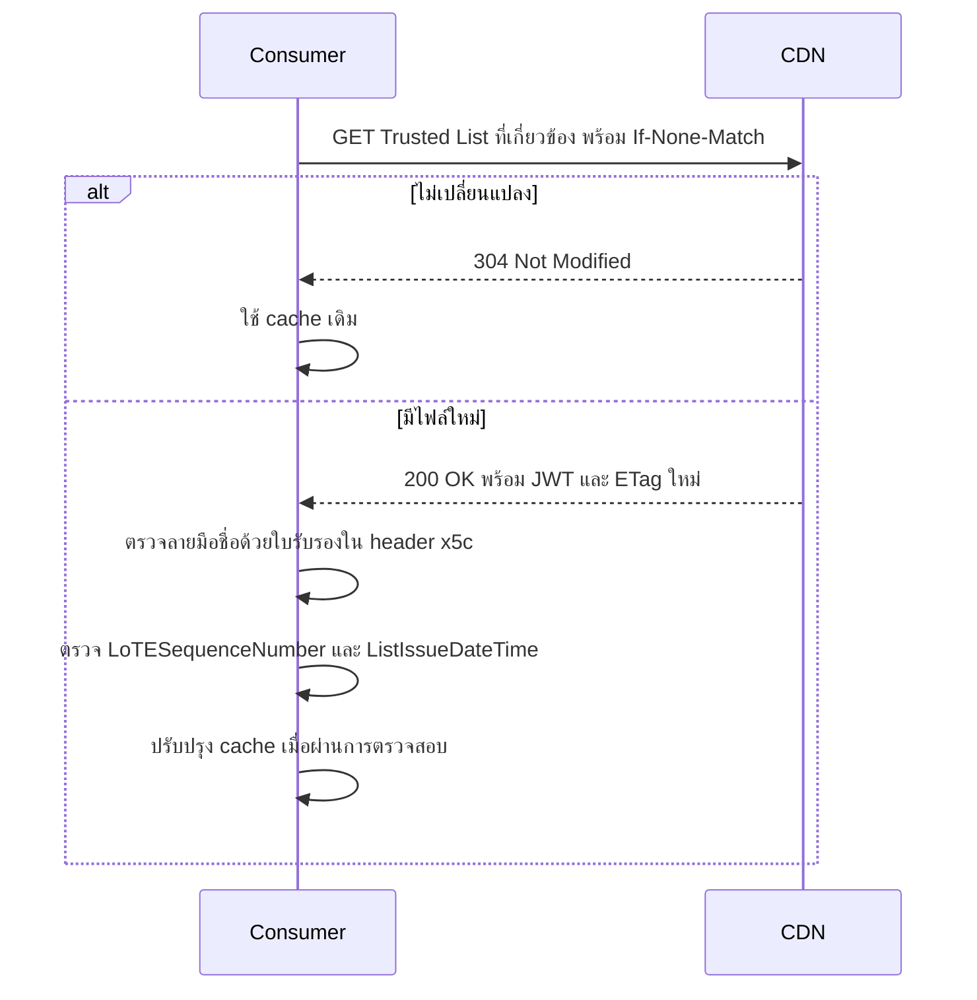

# 12.1 ข้อกำหนดการเผยแพร่ Trusted List

{/* METADATA (agent-only — not rendered to readers)
> **สถานะ:** ส่วนขยายของ Thai VC ARF เวอร์ชัน 2.1 — กำลังย้ายไปใช้ payload แบบ LoTE ใน JWT
> **วัตถุประสงค์:** ระบุประเภท จำนวนไฟล์ รูปแบบ โครงสร้างข้อมูล และตัวอย่างของ Trusted List ที่ใช้ในระบบกระเป๋าเอกสารดิจิทัล (Document Wallet)
> **เอกสารที่เกี่ยวข้อง:** [บทที่ 9 — Trust Model 3](09-trust-model-3.md) · [บทที่ 12 — Key Management และ Trusted List Deployment](12-key-management-and-trustlist-deployment.md) · [บทที่ 13 — VC Status และการเพิกถอน](13-vc-status-and-revocation.md)
*/}

## 12.1.1 ขอบข่าย

เอกสารฉบับนี้สรุปรูปแบบเป้าหมายของ Trust List สำหรับประเทศไทยตาม [ผลการวิเคราะห์ JWT ที่อ้างอิง LoTE](../research/42-trusted-list-lote-jwt-format.md) และ [บทสรุปความสอดคล้องขั้นต่ำ](00-minimal-interoperability-reference.md) โดยแยกข้อมูลที่พบใน JWT ตัวอย่างออกจากเขตข้อมูลที่ Thai profile ยังต้องกำหนดก่อนใช้งานจริง [1][2]

ข้อกำหนดการใช้ Trusted List นี้ใช้ร่วมกันใน Trust Model 1, Trust Model 2 และ Trust Model 3 โดยความแตกต่างของแบบจำลองอยู่ที่วิธีผูกและตรวจสอบกุญแจหรือใบรับรองของเอนทิตี [บทที่ 6.5](06.5-trust-building-mechanism.md)

ดังนั้น ไม่ว่าใช้แบบจำลองใด ระบบต้องดึง Trusted List ที่เกี่ยวข้อง ตรวจลายมือชื่อ JWT ตรวจสถานะ บทบาท และช่วงเวลาที่มีผลใช้ได้ก่อนตัดสินใจเชื่อถือเอนทิตี ห้ามใช้การตรวจสอบสายใบรับรองหรือ DID แทนการตรวจ Trusted List

payload ของ JWT อ้างอิงชื่อและลำดับชั้นข้อมูลของ List of Trusted Entities (LoTE) ตาม ETSI TS 119 602 ส่วนการห่อด้วย JWT จุดเผยแพร่ และกฎรายบทบาทเป็น Thai profile จึงยังไม่อาจกล่าวอ้างความสอดคล้องกับ LoTE ของ EUDI โดยสมบูรณ์ การตรวจสถานะ VC รายฉบับใช้ Token Status List [1][2]

**ผู้ดำเนินการรายการ** สพธอ. เป็นผู้ดำเนินการรายการทั้งสาม เนื่องจากเป็นผู้ลงลายมือชื่อกำกับและเป็น trust anchor ที่ทุกระบบใช้ร่วมกัน ทางเอกชนสามารถสร้าง trustlist ไว้ใช้ดำเนินการเองได้ แต่รายการนั้นถือว่าอยู่นอกขอบเขตที่ สพธอ. รับรอง

## 12.1.2 ประเภทและจำนวนไฟล์

สพธอ. ต้องเผยแพร่ Trust List จำนวน 3 ไฟล์ โดยแยกตามบทบาทของเอนทิตี เพื่อให้ผู้ใช้งานดึงเฉพาะข้อมูลที่จำเป็นต่อการตัดสินใจด้านความน่าเชื่อถือ [1]

| ลำดับ | Trusted List ที่เกี่ยวข้อง | Endpoint | เอนทิตีที่บันทึก | ผู้เรียกใช้หลัก | เหตุการณ์ที่ใช้ตรวจสอบ |
|:---:|---|---|---|---|---|
| 1 | Issuer Trusted List | `https://trustme.etda.or.th/.well-known/iss.jwt` | ผู้ออกเอกสาร (issuer) | Wallet และ Verifier | ก่อนรับหรือก่อนตรวจสอบ VC |
| 2 | Verifier Trusted List | `https://trustme.etda.or.th/.well-known/ver.jwt` | ผู้ตรวจสอบเอกสาร (verifier) | Wallet | ก่อนนำเสนอ VP |
| 3 | Wallet Provider Trusted List | `https://trustme.etda.or.th/.well-known/wp.jwt` | ผู้ให้บริการกระเป๋าเอกสารดิจิทัล (wallet provider) | Issuer และ Verifier | ก่อนออก VC หรือก่อนตรวจสอบ Wallet Unit |

การแยกไฟล์ดังกล่าวทำให้การเปลี่ยนแปลงข้อมูลของบทบาทหนึ่งไม่กระทบ cache ของอีกบทบาทหนึ่ง และทำให้แต่ละระบบดึงข้อมูลเฉพาะที่เกี่ยวข้องกับหน้าที่ของตน [1]

**[ข้อกำหนด]** ก่อนเปิดใช้รายการจริง สพธอ. **MUST** เผยแพร่ Trusted List สาธิตและ `did.json` สาธิตที่ใช้ทดลองได้ โดยแยก URI จากรายการจริง และ **MUST** ประกาศว่ารายการสาธิตใช้ตัดสินความน่าเชื่อถือในการผลิตไม่ได้

## 12.1.3 รูปแบบไฟล์และการเผยแพร่

Trusted List ทั้ง 3 รายการมีเนื้อหาเป็น compact JWS ในรูป `header.payload.signature` ซึ่ง สพธอ. ลงลายมือชื่อและเผยแพร่ผ่าน CDN จุดเผยแพร่ที่ระบุใน §12.1.2 ใช้นามสกุล `.jwt` และมีเนื้อหาเป็น compact JWS ผู้ใช้ข้อมูลต้องตรวจลายมือชื่อด้วย trust anchor ของ สพธอ. ก่อนใช้ payload [1][2]

การดึงข้อมูลต้องใช้ HTTP conditional request โดยเก็บค่า `ETag` จากการตอบกลับครั้งก่อนและส่ง `If-None-Match` เมื่อมีการตรวจสอบครั้งถัดไป หากได้รับ `304 Not Modified` ให้ใช้ Trusted List ที่เกี่ยวข้องซึ่งจัดเก็บไว้เดิม หากได้รับ `200 OK` พร้อมไฟล์ใหม่ ให้ดึง Trusted List ที่เกี่ยวข้องฉบับเต็ม ตรวจลายมือชื่อ และตรวจ `LoTE.ListAndSchemeInformation.LoTESequenceNumber` กับ `LoTE.ListAndSchemeInformation.ListIssueDateTime` ก่อนแทนที่ cache ทั้งนี้ การเผยแพร่ระยะปัจจุบันไม่ใช้ API key, delta หรือไฟล์ CBOR [1][2][3]

`ETag` ใช้ตรวจการเปลี่ยนแปลงของไฟล์ ส่วนความถูกต้องและความครบถ้วนของเนื้อหาต้องตรวจจากลายมือชื่อบน JWT [1]

**[ข้อกำหนด] แหล่งกุญแจที่ใช้ตรวจลายมือชื่อ** ลายมือชื่อบน Trusted List อยู่ใน header ของ JWS ในช่อง `x5c` ซึ่งบรรจุใบรับรองของผู้ลงนาม ผู้ใช้ข้อมูล **MUST** ตรวจลายมือชื่อด้วยใบรับรองใบแรกใน `x5c` และ **MUST NOT** ดึงกุญแจของ สพธอ. จาก DID Document เพื่อตรวจลายมือชื่อ Trusted List

**[ข้อกำหนด] การยืนยันตัวผู้ลงนามด้วย fingerprint** ผู้ใช้ข้อมูล **MUST** ตรวจว่า SHA-256 ของใบรับรองใบแรกตรงกับค่า fingerprint ที่ Thai profile ประกาศไว้สำหรับจุดเผยแพร่นั้น และ **MUST** ได้ค่านั้นมาจากช่องทางที่แยกจากไฟล์ที่ตรวจ ไม่ใช่จากหัว JWT ของไฟล์เดียวกัน

**[ข้อกำหนด] เงื่อนไขของใบรับรองผู้ลงนาม** ใบรับรองผู้ลงนาม **MUST** ออกโดย CA ที่เชื่อถือได้ และ **MUST** มี `C` ใน subject DN ตรงกับ `SchemeTerritory` และ `O` ตรงกับค่าใดค่าหนึ่งใน `SchemeOperatorName` ตาม ETSI TS 119 602 ข้อ 6.8.0 [4]

**[ข้อกำหนด] ลำดับการตรวจและข้อยกเว้นช่วงเปลี่ยนผ่าน** ผู้ใช้ข้อมูล **MUST** ตรวจเงื่อนไขในวรรคที่สามก่อน เมื่อใบรับรองยังไม่ผ่านเงื่อนไข ผู้ใช้ข้อมูล **MUST** ใช้เส้นทาง fingerprint ตามวรรคที่สอง และ **MUST** ระบุในบันทึกการตรวจว่าเป็นการใช้ภายใต้ข้อยกเว้น

ไฟล์ที่เผยแพร่ทั้งสามยังไม่ผ่านเงื่อนไข `O` ในวรรคที่สาม ใบรับรองระบุ `O=Electronic Transactions Development Agency` ขณะที่ `SchemeOperatorName` เป็น `Electronic Transactions Development Agency (ETDA)` สพธอ. **MUST** ทำให้สองค่านี้ตรงกันก่อนเปิดใช้รายการจริง ระหว่างที่ยังไม่ตรง Thai profile ประกาศยกเว้นเงื่อนไข `O` สำหรับรายการชุดปัจจุบัน และผู้ใช้ข้อมูล **MUST** ใช้เส้นทาง fingerprint ตามวรรคที่สองแทน

```text
GET https://trustme.etda.or.th/.well-known/iss.jwt
If-None-Match: "urn:etda:trusted-list:issuer:2026-v42"

304 Not Modified
```

**[ข้อกำหนด]** ผู้เผยแพร่ต้องตอบในแบบที่ทำให้ผู้ดึงใช้ conditional request ได้ตามที่กล่าวข้างต้น ถ้า `ETag` เปลี่ยนทั้งที่ไฟล์ไม่ได้เปลี่ยน หรือตอบ 304 พร้อม body ผู้ดึงจะดาวน์โหลดไฟล์ซ้ำโดยไม่จำเป็น และตรวจการเปลี่ยนแปลงไม่ได้

| สิ่งที่ผู้เผยแพร่ต้องทำ | เงื่อนไข | ระดับ |
|---|---|---|
| ให้ `ETag` คงเดิมเมื่อเนื้อหาไฟล์ไม่เปลี่ยน และเปลี่ยนเมื่อเผยแพร่ไฟล์ใหม่ | ทั้งสามรายการ | MUST |
| ตอบ `304 Not Modified` โดยไม่มี body | เมื่อ `If-None-Match` ตรงกับ `ETag` ปัจจุบัน | MUST |
| ตั้ง `Cache-Control: public, max-age=300, stale-while-revalidate=600` | ทุกไฟล์ | SHOULD |
| ห้ามให้ cache เก็บคำตอบข้อผิดพลาด | ตอบ 5xx หรือ timeout | MUST |

CDN เป็นเพียงทางส่งไฟล์ การตัดสินความน่าเชื่อถือมาจากลายมือชื่อบน JWT ตามข้อ 12.7

## 12.1.4 โครงสร้างข้อมูล

payload ที่ถอดรหัสจาก JWT ตัวอย่างใช้ `LoTE` เป็นวัตถุระดับบน มีข้อมูลรายการใน `ListAndSchemeInformation` และมีรายการองค์กรใน `TrustedEntitiesList[]` โดยแต่ละองค์กรมี `TrustedEntityInformation` และ `TrustedEntityServices[]`

ตารางต่อไปนี้แสดงชื่อเขตข้อมูลที่พบในไฟล์ที่เผยแพร่จริงทั้งสามรายการ คือ `iss.jwt` ลำดับ 9 เผยแพร่ 11 พฤศจิกายน 2569, `ver.jwt` ลำดับ 8 เผยแพร่ 5 พฤศจิกายน 2569 และ `wp.jwt` ลำดับ 7 เผยแพร่ 5 พฤศจิกายน 2569 จาก `trustlist-store-test` ส่วนฟิลด์บังคับทั้งหมดต้องกำหนดใน Thai profile [1]

| เส้นทางใน payload | ข้อมูลที่พบในตัวอย่าง |
|---|---|
| `LoTE.ListAndSchemeInformation.LoTEVersionIdentifier` | เวอร์ชันของโครงสร้างรายการ |
| `LoTE.ListAndSchemeInformation.LoTESequenceNumber` | ลำดับของรายการ ใช้ตรวจ rollback |
| `LoTE.ListAndSchemeInformation.LoTEType` | ชนิดของรายการ; ตัวอย่างผู้ออกกับผู้ให้บริการกระเป๋ายังใช้ URI ของ ETSI (`EUPubEAAProvidersList` และ `EUWalletProvidersList`) ส่วนผู้ตรวจใช้ `http://uri.etda.or.th/19602/LoTEType/ThaiVerifiersList` Thai profile ยังต้องตรึง URI ที่อนุญาต |
| `LoTE.ListAndSchemeInformation.LoTEVersionIdentifier` | เวอร์ชันของโครงสร้างรายการ; ตัวอย่างทั้งสามเป็น `1` |
| `LoTE.ListAndSchemeInformation.SchemeOperatorName[]` | ชื่อผู้ดำเนินการรายการพร้อมภาษา; ตัวอย่างมีเฉพาะ `en` |
| `LoTE.ListAndSchemeInformation.SchemeInformationURI[]` | URI ข้อมูลรายการพร้อมภาษา |
| `LoTE.ListAndSchemeInformation.StatusDeterminationApproach` | URI ของวิธีตัดสินสถานะ; ตัวอย่างผู้ออกและผู้ตรวจใช้ namespace `uri.etda.or.th` ส่วนผู้ให้บริการกระเป๋ายังใช้ URI ของ ETSI |
| `LoTE.ListAndSchemeInformation.SchemeTypeCommunityRules[]` | URI กฎของ scheme พร้อมภาษา |
| `LoTE.ListAndSchemeInformation.HistoricalInformationPeriod` | จำนวนวันที่เก็บข้อมูลย้อนหลัง; ตัวอย่างทั้งสามเป็น `365` |
| `LoTE.ListAndSchemeInformation.NextUpdate` | เวลาที่คาดว่าจะมีฉบับถัดไป; ไฟล์ PoC ตั้งไว้ 30 วันหลัง `ListIssueDateTime` แต่ช่องนี้จะถูกถอดออกใน draft ถัดไป เพราะใช้ short TTL แทน |
| `LoTE.ListAndSchemeInformation.SchemeTerritory` | เขตอำนาจของ scheme เช่น `TH` |
| `LoTE.ListAndSchemeInformation.SchemeName[]` | ชื่อ scheme พร้อมภาษา |
| `LoTE.ListAndSchemeInformation.ListIssueDateTime` | เวลาเผยแพร่รายการ |
| `LoTE.TrustedEntitiesList[]` | รายการองค์กร; ตัวอย่างผู้ออกมี 2 องค์กร ส่วนผู้ตรวจและผู้ให้บริการกระเป๋ามีบทละ 1 องค์กร |
| `TrustedEntitiesList[].TrustedEntityInformation.TEName[]` | ชื่อองค์กรพร้อมภาษา; ตัวอย่างผู้ให้บริการกระเป๋ามีทั้ง `th` และ `en` |
| `TrustedEntitiesList[].TrustedEntityInformation.TEAddress.TEPostalAddress[]` และ `.TEElectronicAddress[]` | ที่อยู่ขององค์กร; `TEAddress` เป็นออบเจกต์ ไม่ใช่อาร์เรย์ |
| `TrustedEntitiesList[].TrustedEntityServices[].ServiceInformation.ServiceTypeIdentifier` | ชนิดบริการ; Thai profile ยังต้องตรึง URI ที่อนุญาต |
| `TrustedEntitiesList[].TrustedEntityServices[].ServiceInformation.ServiceName[]` | ชื่อบริการพร้อมภาษา; บริการทั้งสามรายการในตัวอย่างใช้ `ServiceTypeIdentifier` เดียวกันและแยกกันด้วยชื่อบริการ |
| `TrustedEntitiesList[].TrustedEntityServices[].ServiceInformation.ServiceDigitalIdentity.X509Certificates[]` | ใบรับรอง X.509 ของบริการ; ตัวอย่างผู้ออกเรียงเป็นสายจากใบรับรองบริการถึง root |
| `TrustedEntitiesList[].TrustedEntityServices[].ServiceInformation.ServiceDigitalIdentity.OtherIds[]` | ตัวระบุอื่นของบริการ; บริการที่ไม่มีใบรับรองประกาศ `did:key` ในช่องนี้ |

`TEName[]` มีช่อง `lang` กำกับแต่ละรายการ แต่ Thai profile ไม่บังคับให้มีรายการภาษาไทย

`wp.jwt` ประกาศ URI ของบริการไว้ใน `ServiceSupplyPoints[].uriValue` แล้ว ส่วน `iss.jwt` กับ `ver.jwt` ยังไม่มีช่องนี้ URI ของบริการจึงปรากฏเฉพาะใน `uniformResourceIdentifier` ของใบรับรอง ตัวอย่างผู้ออกประกาศ `https://issuer-test.etda.or.th` ตัวอย่างผู้ตรวจประกาศ `https://oidc.saowarot.com/verify` และตัวอย่างผู้ให้บริการกระเป๋าประกาศ `https://issuer-api-test.etda.or.th/ssi/wallet-unit/v1` ใบรับรองเดียวกันยังมี URI ของ CRL อยู่ด้วย

OID4VP เปิดทางให้ Wallet ที่ไม่ใช่ของหน่วยงานรัฐเลือกส่งหรือไม่ส่ง WIA/WIA-PoP Thai profile ไม่ใช้ทางเลือกนั้น ทุก Wallet ต้องได้ WIA จากผู้ให้บริการกระเป๋าที่อยู่ใน Trusted List และต้องส่ง WIA กับ WIA-PoP ครบคู่ใน OID4VP รวมถึงส่ง Client Attestation ใน OID4VCI ผู้ตรวจสอบจึงไม่ต้องจำแนกประเภท Wallet และไม่ต้องมีแหล่งข้อมูลสำหรับการจำแนก

Thai profile ไม่ใช้ช่องสถานะ บริการที่อยู่ใน Trusted List ถือว่าใช้งานอยู่ เมื่อ สพธอ. ถอนบริการออกจากรายการ บริการนั้นสิ้นสุดความน่าเชื่อถือเมื่อผู้ใช้ดึงรายการฉบับใหม่แล้วไม่พบบริการนั้นอีก การเปลี่ยนแปลงรับรู้ได้จาก `LoTESequenceNumber` ที่เพิ่มขึ้นและ short TTL ไม่ใช่จากค่าในช่องสถานะ

ETSI TS 119 602 ข้อ 6.6.0 กำหนดให้ช่อง `ServiceStatus` ต้องมีเมื่อ `HistoricalInformationPeriod` มากกว่าศูนย์ ไฟล์ที่เผยแพร่ตั้งค่านี้ไว้ 365 จึงมีช่องดังกล่าวใน `wp.jwt` การที่ Thai profile ไม่ใช้ช่องนี้จึงเป็นส่วนเบี่ยงจากมาตรฐาน และระบุส่วนเบี่ยงนี้ไว้ในข้อ 12.1.6 [4] รายการที่ไม่มีช่องสถานะบอกได้เพียงว่าองค์กรเคยขึ้นทะเบียน ไม่ได้บอกว่ายังใช้งานได้

หลักการของไทยกำหนดให้ตรวจขอบเขตสิทธิ์ของ Issuer, Verifier และ Wallet Provider ตามบทบาท แต่ JWT ตัวอย่างทั้งสามยังไม่แสดงฟิลด์ประเภท VC/claims ของ Issuer และ claims กับวัตถุประสงค์ของ Verifier จึงยังไม่อาจยืนยันชื่อและเส้นทางฟิลด์เหล่านั้นจากตัวอย่างได้ Thai profile ต้องกำหนดฟิลด์ดังกล่าวพร้อมกฎการตรวจสอบก่อนใช้งานจริง [1][2]

ผู้ใช้ข้อมูลต้องปฏิเสธการตัดสินใจด้านความน่าเชื่อถือ หากไม่พบบริการที่บทบาทตรงใน Trusted List หรือไม่สามารถยืนยันขอบเขตสิทธิ์ที่จำเป็น ลายมือชื่อ ชนิดรายการ ลำดับรายการ และเวลาที่มีผลใช้ได้จาก profile ที่ประกาศใช้ [1][2]

**[ข้อกำหนด] การจับคู่ผู้ออก** Wallet **MUST** เทียบค่า `credential_issuer` จาก Credential Issuer Metadata กับ URI หนึ่งรายการของบริการ Issuer ใน Trusted List แบบตรงทุกตัวอักษร และ **MUST** ปฏิเสธเมื่อไม่มี URI ที่ตรง ชื่อเขตข้อมูลที่ใช้เก็บ URI นี้ยังไม่ถูกกำหนดในฉบับนี้

การเทียบเกิดที่ระดับบริการ ไม่ใช่ระดับองค์กร องค์กรเดียวมีหลายบริการได้และแต่ละบริการมี URI ของตัวเอง

ข้อกำหนดนี้ใช้ได้เมื่อรายการประกาศ URI ของบริการไว้เท่านั้น สพธอ. **MUST** ประกาศ URI ของบริการในรายการจริงก่อนเปิดใช้ ระหว่างที่ยังไม่มี URI ของบริการให้เทียบ Wallet **MUST** ปฏิเสธทุกคำขอออกเอกสาร และห้ามเดาว่า URI ในใบรับรองบริการแทน URI ของบริการได้

## 12.1.5 ตัวอย่าง payload

ไฟล์ `iss.jwt`, `ver.jwt` และ `wp.jwt` ใช้โครง LoTE เดียวกัน ต่างกันที่ `ServiceTypeIdentifier`, `LoTEType` และชนิดรายการที่บันทึก ตัวระบุ DID ของเอนทิตีอยู่ใน `OtherIds[]`

ตัวอย่างต่อไปนี้คือ payload ของ `iss.jwt` ลำดับ 9 ที่เผยแพร่จริง ตัดใบรับรองให้สั้นลงและคงค่าอื่นไว้ตามเดิม ไม่มีฟิลด์สถานะ ไม่มีฟิลด์ระบุประเภท VC ที่ออกได้ และยังไม่มีการตรวจลายมือชื่อในขั้นตอนนี้ [1]

header ของ JWS ทั้งสามไฟล์มี `alg` เป็น `ES256`, `typ` เป็น `JOSE` และ `x5c` บรรจุใบรับรองสามใบเรียงจากใบผู้ลงนามถึง root ใบผู้ลงนามมี subject `/C=TH/O=Electronic Transactions Development Agency/2.5.4.97=GOVTH-0994000789637` ออกโดย `/C=TH/O=ETDA/CN=THAILAND-DIGITAL-CREDENTIAL-SUBCA-03` และมีอายุ 29 ตุลาคม 2569 ถึง 27 เมษายน 2570

```json
{
  "alg": "ES256",
  "typ": "JOSE",
  "iat": 1794377372,
  "x5c": [
    "MIICrjCCAlSgAwIBAgIIcaLwkiblzEQ…",
    "MIICfTCCAd+gAwIBAgIIEtcWqEFP1G4…",
    "MIICeDCCAdqgAwIBAgIIIYeIxemrUqk…"
  ]
}
```

```json
{
  "LoTE": {
    "ListAndSchemeInformation": {
      "LoTEVersionIdentifier": 1,
      "LoTESequenceNumber": 9,
      "LoTEType": "http://uri.etsi.org/19602/LoTEType/EUPubEAAProvidersList",
      "SchemeOperatorName": [
        {"lang": "en", "value": "Electronic Transactions Development Agency (ETDA)"}
      ],
      "SchemeInformationURI": [{"lang": "en", "uriValue": "https://www.etda.or.th"}],
      "StatusDeterminationApproach": "http://uri.etda.or.th/19602/ThaiIssuersList/StatusDetn/ETDA",
      "SchemeTypeCommunityRules": [
        {"lang": "en", "uriValue": "http://uri.etda.or.th/19602/ThaiIssuers/schemerules/ETDA"}
      ],
      "SchemeTerritory": "TH",
      "SchemeName": [{"lang": "en", "value": "Thai Issuers List"}],
      "HistoricalInformationPeriod": 365,
      "ListIssueDateTime": "2026-11-11T06:09:32Z",
      "NextUpdate": "2026-12-11T06:09:32Z"
    },
    "TrustedEntitiesList": [
      {
        "TrustedEntityInformation": {
          "TEName": [{"lang": "en", "value": "Saowarot Demo Issuer"}]
        },
        "TrustedEntityServices": [
          {
            "ServiceInformation": {
              "ServiceTypeIdentifier": "http://uri.etsi.org/19602/SvcType/PubEAA/Issuance",
              "ServiceName": [{"lang": "en", "value": "PubEAA Issuance"}],
              "ServiceDigitalIdentity": {
                "X509Certificates": [
                  {"val": "MIICjjCCAjSgAwIBAgIIEORyLah/ayY…"},
                  {"val": "MIICfTCCAd+gAwIBAgIIEtcWqEFP1G4…"},
                  {"val": "MIICeDCCAdqgAwIBAgIIIYeIxemrUqk…"}
                ]
              }
            }
          }
        ]
      },
      {
        "TrustedEntityInformation": {
          "TEName": [
            {"lang": "en", "value": "Electronic Transactions Development Agency (ETDA)"}
          ]
        },
        "TrustedEntityServices": [
          {
            "ServiceInformation": {
              "ServiceTypeIdentifier": "http://uri.etsi.org/19602/SvcType/PubEAA/Issuance",
              "ServiceName": [{"lang": "en", "value": "Role model certificate"}],
              "ServiceDigitalIdentity": {
                "OtherIds": ["did:key:z6MkoMku1eaYFD7rGnhS9rD2bGyydvPmE3UiW57MQYdAYjJR"]
              }
            }
          },
          {
            "ServiceInformation": {
              "ServiceTypeIdentifier": "http://uri.etsi.org/19602/SvcType/PubEAA/Issuance",
              "ServiceName": [{"lang": "en", "value": "EmployeeID demo"}],
              "ServiceDigitalIdentity": {
                "X509Certificates": [{"val": "MIICjjCCAjSgAwIBAgIIEORyLah/ayY…"}]
              }
            }
          }
        ]
      }
    ]
  }
}
```

โครงสร้างการตรวจสอบใช้ลำดับดังรูปแบบต่อไปนี้ โดยการตัดสินใจต้องเกิดภายหลังการตรวจลายมือชื่อและเวลาที่มีผลใช้ได้ของข้อมูลแล้ว [1]



## 12.1.6 ข้อกำหนดสำหรับผู้ใช้ข้อมูล

Wallet, Issuer และ Verifier ต้องใช้เฉพาะ JWT ที่ผ่านการตรวจลายมือชื่อแล้ว ต้องตรวจ `LoTEType`, `LoTESequenceNumber` และ `ListIssueDateTime` ใน `LoTE.ListAndSchemeInformation` ก่อนใช้ข้อมูล และต้องไม่ถือว่ารายการที่ยังไม่ระบุขอบเขตสิทธิ์เป็นรายการที่อนุญาตให้ใช้จริง

**หมายเหตุ: `NextUpdate` กำลังจะถูกถอดออก.** รูปแบบเป้าหมายใช้ short TTL แทนการประกาศวันหมดอายุล่วงหน้า ผู้ใช้ดึงรายการใหม่ตาม TTL หรือเมื่อ `ETag` เปลี่ยน ไม่รอจนถึง `NextUpdate` ไฟล์ PoC ที่เผยแพร่ยังมีช่องนี้อยู่และจะปรับใน draft ถัดไป ระหว่างนี้ **MUST NOT** ใช้ `NextUpdate` เป็นตัวกำหนดอายุของสำเนา ให้ยึด soft TTL และ maximum staleness ตามบทที่ 12 เป็นเงื่อนไข

ในไฟล์ PoC ค่า `NextUpdate` อยู่ห่างจาก `ListIssueDateTime` 30 วัน ค่านั้นเป็นเพดานของฉบับ PoC เท่านั้น ไม่ใช่สิทธิ์ของผู้ใช้ข้อมูลในการใช้สำเนาเก่า และจะหายไปพร้อมช่องนี้ใน draft ถัดไป ส่วนเงื่อนไขความสดยังใช้ soft TTL และ maximum staleness ตามข้อ 12.8 [1][2]

การมีเขตข้อมูลอื่นนอกเหนือจากที่ระบุในข้อ 12.1.4 **MUST NOT** เป็นเหตุให้ปฏิเสธ Trusted List ที่ลายมือชื่อถูกต้อง และเขตข้อมูลเหล่านั้น **MUST NOT** มีผลต่อการตัดสินใจด้านความน่าเชื่อถือ

การถอนบริการออกจาก Trusted List ต้องมีผลต่อการตัดสินใจของระบบในครั้งถัดไปที่มีการเชื่อมต่อและตรวจสอบ Trust List ใหม่ ทั้งนี้ การตรวจสอบ Trust List ดำเนินการเมื่อเกิดการเชื่อมต่อที่ต้องมีการตัดสินใจด้านความน่าเชื่อถือ ไม่ใช้การ polling เบื้องหลัง [1]

## 12.1.7 เอกสารอ้างอิง

[1] [การย้ายรูปแบบ Trusted List ไปสู่ JWT ที่อ้างอิง LoTE](../research/42-trusted-list-lote-jwt-format.md), เวอร์ชัน 1.2, 25 กันยายน 2569

[2] [ชุด VC ของประเทศไทย — สรุปหนึ่งหน้า](00-minimal-interoperability-reference.md), หัวข้อ Trusted List

[3] [แนวทางกระจาย Trusted List ผ่าน File/Edge CDN](../research/41-trustlist-serving-filecdn-etag-binary.md), เวอร์ชัน 1.10, 4 กันยายน 2569 (ใช้เฉพาะวิธีเผยแพร่และ ETag)

[4] European Telecommunications Standards Institute (ETSI), “ETSI TS 119 602 V1.1.1 (2025-11) — Electronic Signatures and Infrastructures (ESI); Lists of trusted entities; Data model”, https://www.etsi.org/deliver/etsi_ts/119600_119699/119602/ (เข้าถึงเมื่อ 16 พฤศจิกายน 2569)

---

**การนำทาง:** [⬅️ บทที่ 12 — Key Management และ Trusted List Deployment](12-key-management-and-trustlist-deployment.md) · [⬆️ สารบัญ ARF](README.md) · [บทที่ 13 — VC Status และการเพิกถอน ➡️](13-vc-status-and-revocation.md)
